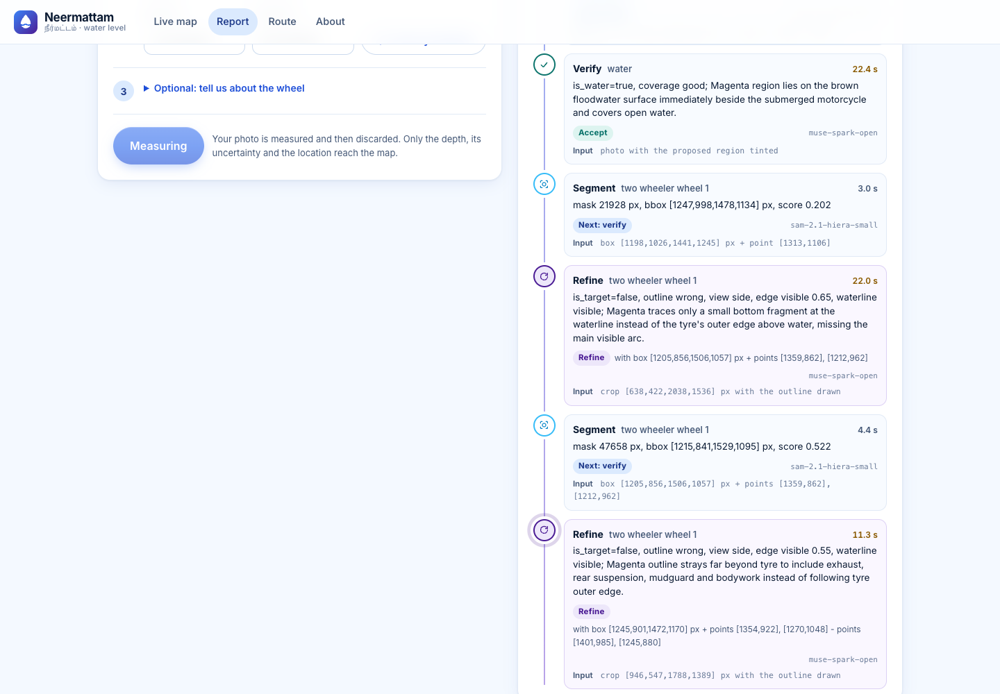
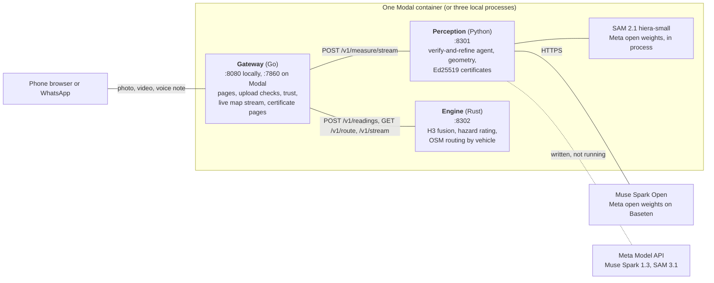

# Neermattam

**Street-level flood depth from one phone photo, measured with a wheel or a person as the ruler, fused into a live map that routes each kind of vehicle around water it cannot cross.**


**Live site:** https://applemacbook6sep2004--neermattam-web-web-serve.us-east.modal.run

Every northeast monsoon, a rider in Chennai stops at the edge of a flooded street and has to guess. Ankle deep, the scooter gets through. Knee deep, the engine drowns and the rider is stuck in moving water. Forecasts tell the city where it will flood; nothing tells that rider how deep the water is on this street, right now. Neermattam (Tamil for "water level") answers with a measurement. A photo of a wheel or a person already standing in the water becomes a depth in centimetres with an honest uncertainty, and many such reports become a live map and a route for a two-wheeler, an auto, a car, a bus or someone on foot.

I built it alone for the Meta Global AI Developer Hackathon, Indie track.

## What happens to one photo

1. **Muse Spark Open reads the scene.** Is there standing water? Where are the vehicles, wheels, people and faces? It also gives its own visual estimate of the depth.
2. **SAM 2.1 outlines the wheel or person and the water.** Proposals are ranked by wheel shape, tyre darkness and plausible size.
3. **The agent verifies and refines.** The best two outlines go back to Muse Spark Open on a close crop. It picks one, rejects both, or sends SAM a corrected box, at most twice. Numeric checks can overrule its "good": a dark ring outside the outline means it traced the rim. The whole request has a 55 s budget.
4. **Geometry gives the depth and its sigma.** The waterline across a wheel is a chord of a circle of known diameter, so the depth is a fraction of that diameter and camera distance cancels out ([docs/GEOMETRY.md](docs/GEOMETRY.md)). Failing a wheel, an adult standing upright is measured against an Indian stature prior. Failing both, the scene model's estimate is returned, labelled as an estimate, with a sigma of at least 20 cm.
5. **A signed certificate is issued** over the input hash, models, prompt versions, every agent step and every number.
6. **Fusion and routing.** The gateway scores trust, and the engine fuses the reading into an H3 hex cell (edges of about 66 m) with a per-cell Kalman filter, then routes each vehicle on the OpenStreetMap road graph within its depth limit.





On Modal a Go launcher adds a front proxy (:8000) and a model budget guard (:8300) ([docs/DEPLOY.md](docs/DEPLOY.md)). Contracts: [docs/CONTRACTS.md](docs/CONTRACTS.md).

## How I use Meta's models

| Model | Where it runs | What it does | Status |
|---|---|---|---|
| Muse Spark Open | Baseten (`meta-models/muse-spark-open-1026`) | Scene reading, the second waterline, verification of every wheel and water mask, voice notes | Running |
| SAM 2.1 hiera-small | CPU, inside the container | Wheel, person and water masks; its video predictor tracks floating debris for surface speed | Running (video speed is experimental) |
| SAM 3.1 | Meta Model API adapter; loader in the Modal SAM service | Masks, and tracking debris by noun phrase instead of by box | Written behind the same interface, not running |
| Muse Spark 1.3 | Meta Model API adapter | Scene reading on the hosted path | Written behind the same interface, not running |

Muse Spark Open is the only reasoning model in the system, and it works as a judge as much as a reader: shown two candidate outlines, it has to say which follows the tyre, and why. Its voice prompt accepts notes in twelve languages, mixed or not (Hindi, Tamil, Telugu, Kannada, Malayalam, Bengali, Marathi, Gujarati, Punjabi, Odia, Urdu and English), and [`voice.py`](perception/src/neermattam_perception/voice.py) turns words like "knee deep" into a depth range. That parser is tested on 36 written phrases, three in each language (`perception/tests/test_voice.py`); recognising the speech itself has not been evaluated per language, and in one recorded test a Bengali note came back transcribed in Devanagari and labelled Hindi (the depth word still mapped).

Why the rest is not running: SAM 3.1's weights are gated on Hugging Face and my access has not been approved (downloads answer 403, [docs/MODAL.md](docs/MODAL.md)), and the hosted Meta Model API account cannot make calls until a credit card is added. The adapters are in [`adapters.py`](perception/src/neermattam_perception/adapters.py) and [`sam_local.py`](perception/src/neermattam_perception/sam_local.py) and switch on with `NEERMATTAM_SCENE` and `NEERMATTAM_MASKS`. Muse Voice Transcribe on the hosted API is not written yet. Velocity from video runs on SAM 2.1: Muse Spark Open boxes the floating objects on a key frame and SAM 2.1's video predictor follows each box ([eval/RESULTS_VIDEO.md](eval/RESULTS_VIDEO.md)); with SAM 3.1 the noun phrase would be tracked instead.

## Safety by design

The worst thing this system could do is call a flooded road safe. The rules against that are written down and tested ([docs/ENGINE.md, Safety model](docs/ENGINE.md#safety-model)):

* **Unknown is never safe.** A cell with no report, a stale report or too much uncertainty is shown as unknown, in grey hatching, never as clear.
* **Uncertainty is carried everywhere.** A road closes to a vehicle when depth plus 1.5 sigma, plus growth with age, exceeds its limit: 15 cm for cars, autos and two-wheelers, 30 cm for buses. Old reports never drain away on their own, and conflicting reports widen the estimate instead of averaging out.
* **Routes are advisory**, and every route and alert says so.
* **Shallow-side errors fall back to caution.** A wheel reading shallower than the scene model's estimate beyond its own two-sigma bound is not published; the estimate is returned with the reason. In one run on the real photos (30 October, `eval/out/final3`, described in [eval/RESULTS_REAL.md](eval/RESULTS_REAL.md)) it set aside two readings, one clearly wrong and one possibly right; in the run recorded at the end of that file no wheel outline reached the geometry, so it had nothing to set aside. That is the price of never publishing a falsely shallow depth.
* **Faces are blurred** in the overlay, the verifier's crops and the stored photo, and GPS metadata is stripped.

## Verify any measurement

Each report links a "Verify this measurement" page (`/verify/{measurement_id}`, in all eight languages) that checks the Ed25519 signature and whether the input hash matches the uploaded file. The public keys are at [`/.well-known/neermattam-keys.json`](https://applemacbook6sep2004--neermattam-web-web-serve.us-east.modal.run/.well-known/neermattam-keys.json). The signed record itself is served at `/api/certificates/{measurement_id}`. Anyone can recompute the published depth and sigma from it with the service's own geometry and no model calls:

```sh
cd perception
uv run python -m neermattam_perception.replay cert.json \
  --keys https://applemacbook6sep2004--neermattam-web-web-serve.us-east.modal.run/.well-known/neermattam-keys.json
```

Exit status 0 is a match and 1 a mismatch; a bad signature stops at 2. A live run on a Chennai photo replayed to a match on every recorded number ([docs/VERIFY.md](docs/VERIFY.md)).

## Results

Every number below is copied from the linked file and comes from a script anyone can rerun.

**Synthetic wheels** ([docs/GEOMETRY.md](docs/GEOMETRY.md), section 7): 500 rendered 3D scenes with noisy masks; 78% measured, the rest declined with a reason. Mean absolute error 3.34 cm, median 1.25 cm; 85% of errors within one stated sigma, 95% within two. The engine blocks at depth plus 1.5 sigma, and 7.9% of true depths lay above that line, against an ideal 6.7%.

**Synthetic people** (same file, section 9.7): 394 of 400 figures measured, mean absolute error 6.5 cm, 4.4 cm low on average, 87% within one sigma. The figures use the proportions the method assumes, so this checks the algorithm, not real bodies.

**Eval gate** ([eval/baseline.json](eval/baseline.json)): a smaller fixed-seed run that fails if accuracy, coverage or calibration slips. Wheels 80.5% measured, 3.90 cm mean error, 83.9% within one sigma; people 98.5%, 6.50 cm, 86.5%.

**Real photos** ([eval/RESULTS_REAL.md](eval/RESULTS_REAL.md)): there is no ground truth. Nobody measured the water in these eleven street photos, so nothing here is accuracy. In the run of 30 October two photos were answered by a person measurement and nine by the labelled model estimate, with no wheel measurement. On 1 November 22 more photos chosen for the wheel method were run: one (a motorcycle in Kanchipuram) measured 4.5 cm from its rear wheel with the outline on the tyre, the same in 6 of 6 runs that reused one scene reading but in none of 4 with a fresh one; two more published from outlines that do not follow the tyre, and the shallow-side guard set aside three readings that were too shallow. The file shows every agent step and its reasons.

**Photos across India** ([eval/RESULTS_INDIA.md](eval/RESULTS_INDIA.md), list in [eval/india_photos.json](eval/india_photos.json)): fourteen archival street flood photos from Wikimedia Commons, from 2006 to 2024, in Chennai (4), Mumbai (2), Bengaluru (3), Hyderabad (2) and Kolkata (3), each placed by its camera geotag or a named locality, measured once on 1 November 2026 by the perception service in its deployed configuration. All fourteen were answered by the labelled model estimate (8 to 45 cm, sigma 20 to 30 cm); none produced a wheel or person measurement, and most runs reached the 55 s time budget on this Mac. There is no ground truth. Model cost for the run: USD 0.41. No suitable photo with a known place was found for Delhi or Visakhapatnam. The map shows these as a separate "Archival photos" layer, labelled "Photo from <year>, run through Neermattam on <date>", each with its signed certificate; they never enter the live map.

**Latency and cost** (the run in eval/RESULTS_REAL.md): 7.2 to 50.2 s per photo, median 31.3 s, of which the scene reading took 7.2 to 14.2 s. Baseten cost USD 0.003 to 0.040 per photo.

**Engine** ([docs/ENGINE.md](docs/ENGINE.md), Benchmarks), on an 8 GB M1 MacBook Air: fusing one reading into a cell and its six neighbours takes 1.11 µs, or 46 µs through the full HTTP router. A 3.5 km car route from Velachery to Guindy takes 0.28 ms on a dry map, 1.3 ms with 200 readings and 29 ms with 2,000. These were measured at commit f8e8fb6 and not refreshed since, as the doc explains. All seven city road graphs (9,513,890 directed edges, 254.1 MiB) load in parallel; the largest, Delhi's, parses in 1.1 s and builds in 0.8 s (docs/ENGINE.md, Graph sizes, 31 October).

## Run it yourself

You need Rust, Go, [uv](https://docs.astral.sh/uv/), `osmium` for the road extract, and a Baseten key for Muse Spark Open. Copy [`.env.example`](.env.example) to `.env` and fill in `BASETEN_API_KEY`, `BASETEN_BASE_URL` and `BASETEN_MODEL`.

The road extract is not in git. From the repository root, cut Chennai's with the recipe in [docs/ENGINE.md](docs/ENGINE.md) and Chennai's documented box:

```sh
mkdir -p data/osm
curl -4 -LO https://download.geofabrik.de/asia/india/southern-zone-latest.osm.pbf
osmium extract -s complete_ways -b 80.06,12.79,80.34,13.28 southern-zone-latest.osm.pbf -o chennai-bbox.osm.pbf
osmium tags-filter chennai-bbox.osm.pbf w/highway -o data/osm/chennai-roads.osm.pbf
```

Then start the three services, each in its own terminal:

```sh
cd engine && ENGINE_CITIES=chennai cargo run --release              # 127.0.0.1:8302
cd perception && uv sync --extra local && uv run --extra local neermattam-perception   # 127.0.0.1:8301
cd gateway && DEMO=1 go run ./cmd/neermattam-gateway                 # http://localhost:8080
```

The map opens on real data only: live reports, Open-Meteo rainfall for every city and the measured archival photos. `DEMO=1` also seeds a simulated Cyclone Michaung scenario onto the engine's separate replay layer, which a visitor switches on in Chennai ("Replay a past flood: Cyclone Michaung, December 2023, simulated") and which the public control room demo uses. It never reaches the live map, its numbers or `/api/india`. Tests and the eval gate:

```sh
cd engine && cargo test
cd gateway && go test ./...
cd perception && uv run pytest && uv run python ../eval/gate.py
cd mcp && uv run pytest
```

The public deployment is one command, `modal deploy deploy/modal-web/app.py`; [docs/DEPLOY.md](docs/DEPLOY.md) covers secrets, the daily cap of 150 measurements and the running cost.

## MCP server

[`mcp/`](mcp/README.md) is a Model Context Protocol server, so any AI agent or assistant (Claude Desktop, Cursor, Claude Code or any MCP client) can ask the live site how deep the water is near a point, which route is open for a vehicle, what state a data centre's rings and access routes are in, measure a photo and check a measurement's certificate. It calls the public API (and the developer API when given a key), keeps the same rules (advisory, unknown is never safe, every depth with its sigma) and ships with mocked tests and a live smoke script whose real output is in its README.

```sh
cd mcp && uv sync && uv run neermattam-mcp
```

## Built during the hackathon

The hackathon runs from 26 October to 4 November 2026. This repository was started on 26 October, the first day of the event, and everything in it was written during the event. The first commit is `136b667`, dated 2026-10-26, "Build rules, layout and service contracts"; `git log --reverse` shows the rest.

Third-party pieces I did not write:

| Piece | How it is used | Licence |
|---|---|---|
| MapLibre GL JS 5.6.0 | Vendored in `gateway/internal/web/static/vendor/` | BSD 3-Clause ([LICENSE.txt](gateway/internal/web/static/vendor/maplibre-gl-5.6.0/LICENSE.txt)) |
| Inter typeface | Vendored | SIL Open Font License 1.1 ([licence](gateway/internal/web/static/fonts/LICENSE-Inter.txt)) |
| Plus Jakarta Sans typeface, for headings | Vendored | SIL Open Font License 1.1 ([licence](gateway/internal/web/static/fonts/LICENSE-PlusJakartaSans.txt)) |
| Noto Sans for Indic scripts | Loaded from Google Fonts | SIL Open Font License 1.1 |
| OpenStreetMap road extracts, seven cities | Cut from Geofabrik extracts, not in git | ODbL 1.0 |
| OpenFreeMap base map tiles | Loaded by the map | OpenStreetMap and OpenMapTiles attribution |
| Open-Meteo rainfall | Called at run time | CC BY 4.0 |
| SAM 2.1 hiera-small weights | Downloaded at build time | Apache 2.0 |
| Muse Spark Open | Called through Baseten; no weights in this repository | Meta's terms for the model |
| Evaluation photos | Downloaded by `eval/real_photos.py`, not in git | CC0, CC BY 2.0, CC BY 3.0, CC BY-SA 4.0 and Unsplash License, credited per photo |
| Sample and showcase photos on the site | Four evaluation photos, faces and plates blurred, in `gateway/internal/samples` and `static/showcase` | CC0 1.0, CC BY 2.0, CC BY 3.0 and Unsplash License, credited on the page and in `samples.json` |

Library dependencies are pinned in `engine/Cargo.lock`, `perception/uv.lock` and `mcp/uv.lock`. The gateway uses only Go's standard library.

## Languages and cities

Every page, message and result card is available in English, Tamil, Hindi, Telugu, Kannada, Malayalam, Bengali and Marathi ([docs/GATEWAY.md](docs/GATEWAY.md)). The engine covers seven cities by default (`ENGINE_CITIES`): Chennai, Mumbai, Bengaluru, Hyderabad, Kolkata, Delhi and Visakhapatnam, each with its own road graph. Another city needs only configuration.

The live map opens on real data in every city. Each city shows its modelled rainfall for the last hour and the last 24 hours from Open-Meteo, read every 10 minutes and shown with the time it was read (or "rain data unavailable", never zero), and a strip of all seven cities with their real reports, rainfall and measured photos, one tap apart. A city with no reports says so and points to the cities that have reports or rain. `GET /api/india` gives the same numbers as JSON ([docs/CONTRACTS.md](docs/CONTRACTS.md), section 3).

## Limits and what's next

* No field accuracy yet. The next step is real photos with a measured depth beside them.
* The wheel method rarely measures a real photo yet. Of 33 real photos run so far, one gave a wheel depth from an outline on the tyre, and it does not reproduce with a fresh scene reading. SAM keeps the mudguard with a two-wheeler's tyre and the arch with a car's, and the verifier accepts some of those outlines at low reasoning effort ([eval/RESULTS_REAL.md](eval/RESULTS_REAL.md), first section). The labelled estimate and the person reference answer the rest.
* The scene model's own estimates are uncalibrated, and moved by up to 60 cm between runs on one photo.
* Latency depends on Baseten; on slow days it was two to six times longer.
* No published source was found for the auto, two-wheeler or bus depth limits. The first two borrow the car figure.
* Video speed is experimental: on five real clips none had both a measured reference and tracks good enough for a speed in metres per second ([eval/RESULTS_VIDEO.md](eval/RESULTS_VIDEO.md)).
* Next: SAM 3.1 once access is approved, and one ward pilot with a city control room ([docs/IMPACT.md](docs/IMPACT.md)).

## Licence and data credits

The code is under the [MIT License](LICENSE). Road data is © OpenStreetMap contributors under the ODbL; the attribution for the road extracts, the SAM 2.1 weights and Open-Meteo is in [deploy/hf-space/DATA_LICENSE](deploy/hf-space/DATA_LICENSE), and the About page on the live site credits them too.
