# Neermattam gateway

The gateway is the Go service at `gateway/` (port 8080) and the only service the public can reach. It serves the pages in eight languages for six cities, takes reports from the web and WhatsApp, checks them, hands them to perception and the engine, and fans the engine's live cell stream out to browsers. It is written with the standard library only: `net/http` with method patterns, `log/slog`, `html/template` and `embed`. There are no third-party Go modules.

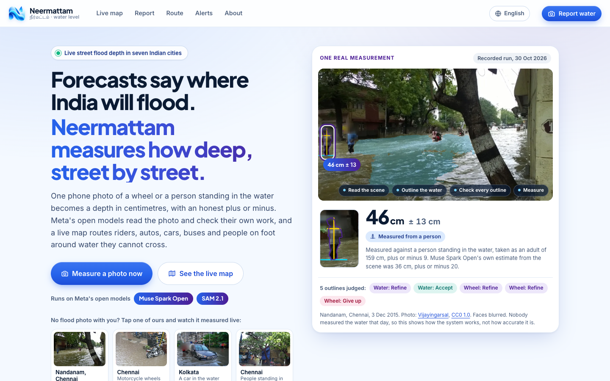

## Pages

| Path | What it is |
|---|---|
| `/` | The landing page: the hero line, a live preview of the map, how it works in four steps, a recorded agent trace, the two Meta models, who it is for, honest numbers read from the project's documents, and the safety note. See [Landing page](#landing-page). `/?at=...` (the old map link format) redirects to `/map`. |
| `/map` | The live map. Hex cells from `/api/cells`, updated over `/api/stream`. Legend for depth bands and hazard classes, a popup per cell (depth plus or minus sigma, upper estimate, velocity, hazard, reports, age, origin), a live report ticker, and the advisory note. |
| `/report` | Upload a photo, a short video or a voice note, with a location from a map tap, the device or typed coordinates. Shows the real pipeline stages as they happen and ends with the result card. |
| `/route` | Pick start and end on the map or from presets (Velachery station, Guindy, T. Nagar, Tambaram, Chennai Central) and a vehicle. Draws the water-aware route and the shortest route in two styles, with the engine's summary and explanation. |
| `/about` | How it works, the hazard formula and vehicle limits, checks, credits and limitations. |
| `/alerts` | "Watch my street": pick a point or a planned route and a vehicle, and get a notification when the water there crosses the vehicle's limit, gets more dangerous, or clears. See [Watch my street](#watch-my-street). |
| `/control` | The control room for ward officers and city control rooms, behind an access key; `/control/demo` is a public read-only copy over the simulated Chennai scenario. See [Control room](#control-room). |
| `/developers` | The developer API for fleets, with curl examples, response fields, errors, limits and the advisory terms. See [Developer API](#developer-api). |

Every route is in docs/CONTRACTS.md section 3.

Pages are server-rendered. The only script is the vendored MapLibre GL JS 5.6.0 (`gateway/internal/web/static/vendor/maplibre-gl-5.6.0/`, BSD licence) and short inline glue. Every inline script carries a per-request nonce, and the Content-Security-Policy allows only those scripts, the gateway's own files and OpenFreeMap (style, tiles, glyphs, sprites). Without script, the report form and the route form still work: they post or get to the same paths and the server renders the result.

Base map: OpenFreeMap's Positron style, recoloured toward the palette at load time, with OpenStreetMap and OpenMapTiles attribution kept in the map corner. The Inter typeface is vendored (OFL).

| Desktop | Mobile |
|---|---|
| 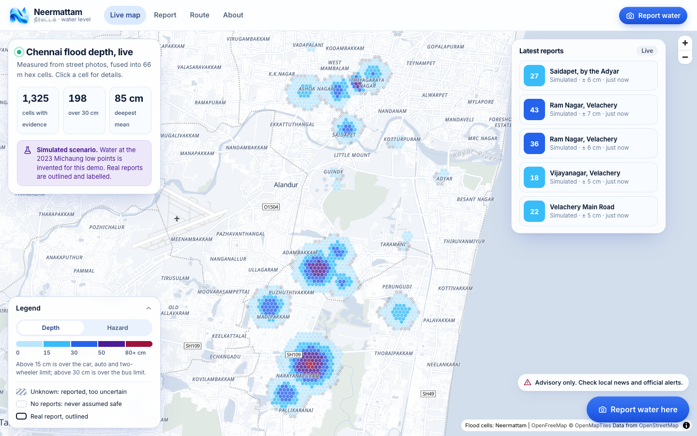 | 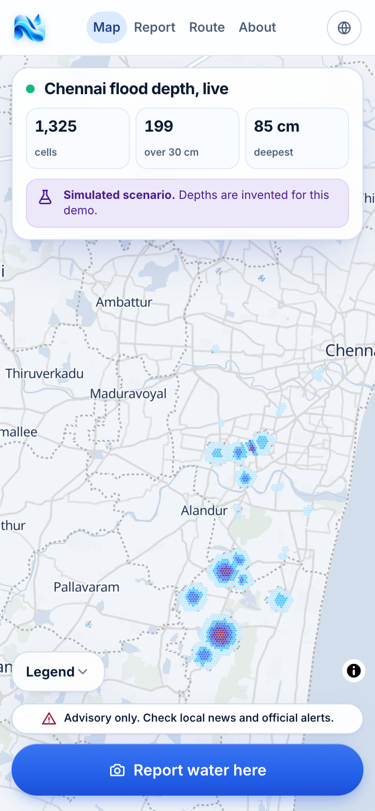 |
| 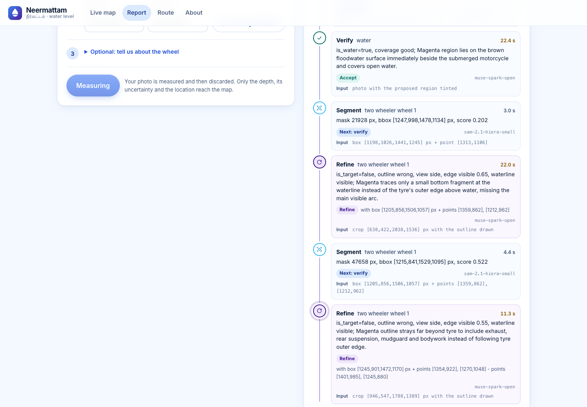 | 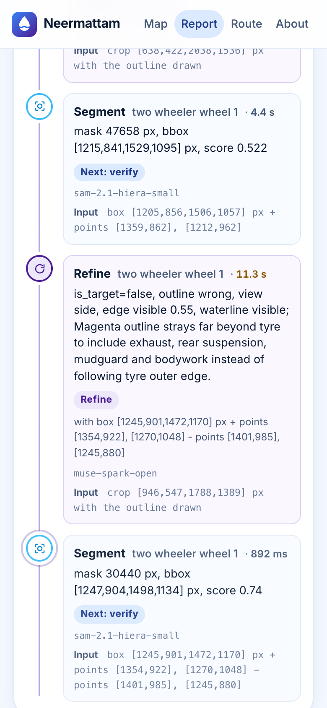 |
| 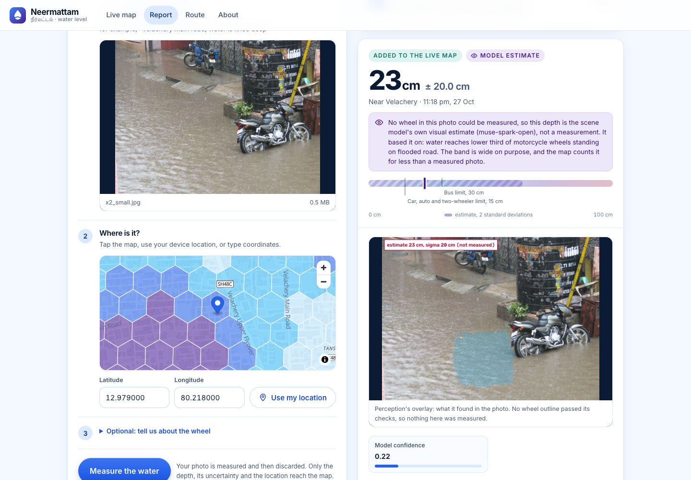 | 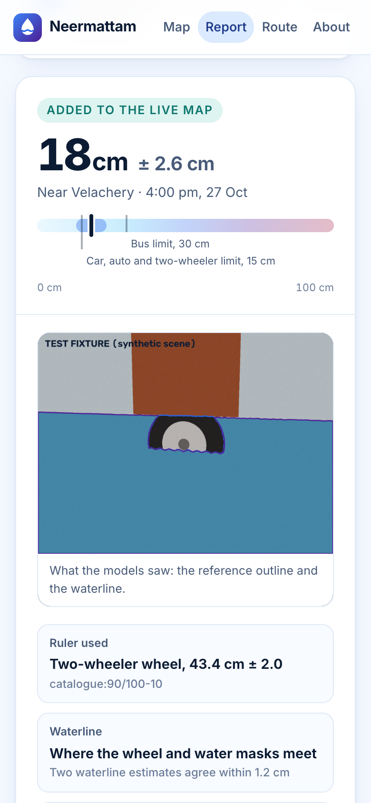 |
| 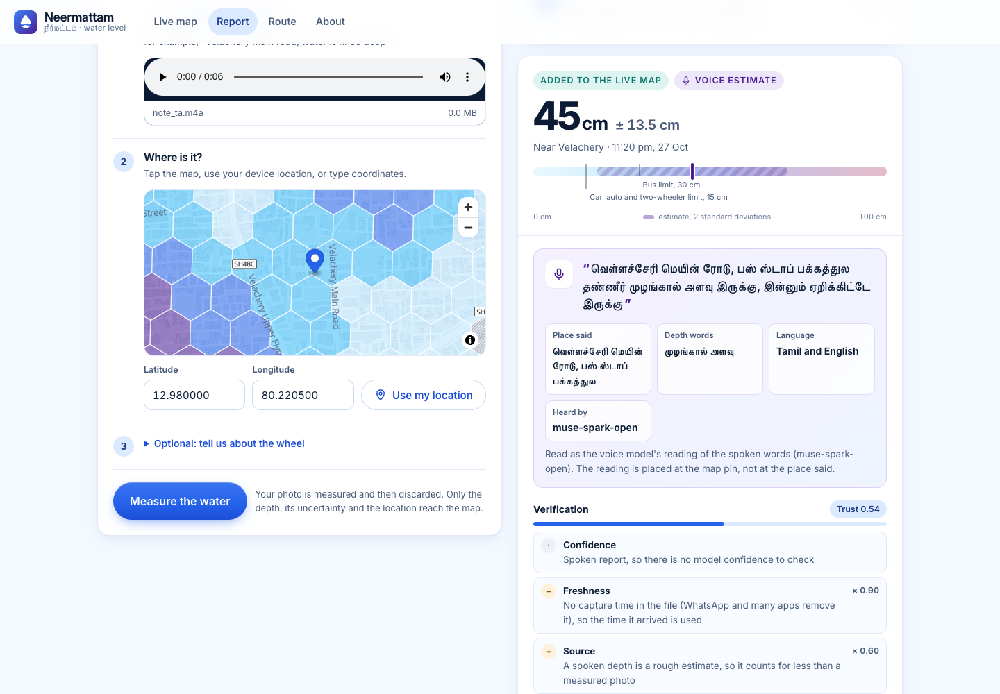 | 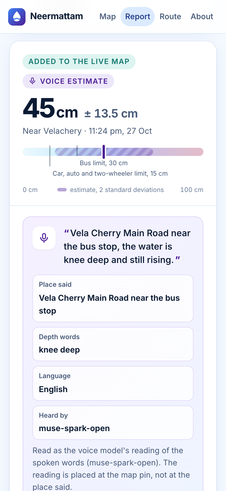 |
| 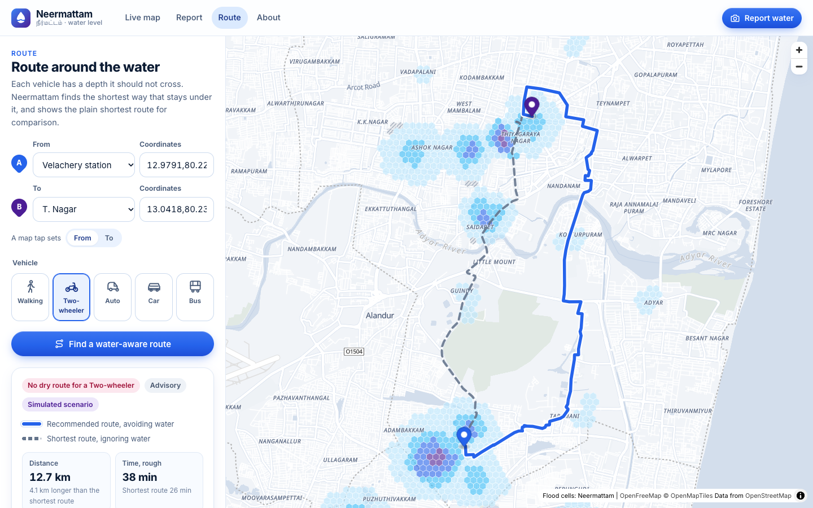 | 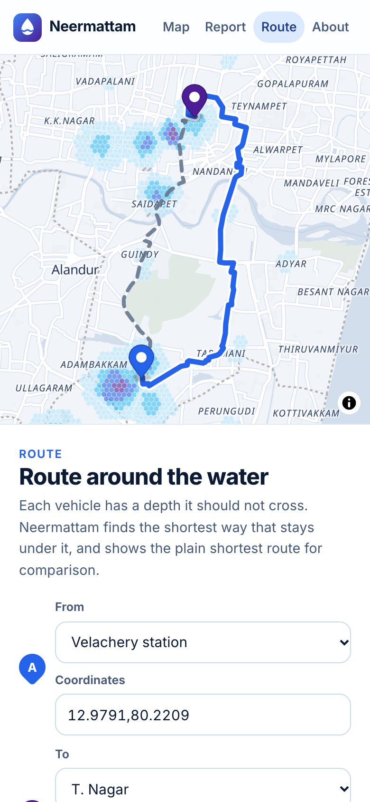 |

Where the report screenshots come from, because it matters:

- `gateway-report-voice.png` and `gateway-report-voice-mobile.png` are live runs: a Tamil and an English voice note, spoken by the macOS voices Vani and Rishi, transcribed by the real perception service (Muse Spark Open on Baseten) and fused by the real engine.
- `gateway-report-real-rejected.png` and `gateway-report-waiting.png` are a live run of the real perception service on the Commons photo "India - Chennai - Monsoon - 04" by McKay Savage (CC BY 2.0). Perception found no measurable wheel and returned a model estimate; the gateway refused it because the photo was taken in 2008.
- `gateway-report-trace*.png` and `gateway-report-result*.png` replay a recorded live perception response, `eval/out/x2.json` (Muse Spark Open and SAM 2.1 on "India - Chennai - Monsoon - 02" by McKay Savage, CC BY 2.0), through a small server that sends its 18 steps over `/v1/measure/stream`, since that endpoint was still being built. Every step, output and latency is the recorded one; only the pacing between steps is the replay's. Its `captured_at` was set to null so the 2008 photo is not refused as stale.
- `gateway-report-result-geometry.png` uses a fixture perception server on a synthetic scene (`perception/src/neermattam_perception/synth.py`), because no real photo has yet produced a wheel measurement (see `eval/RESULTS_REAL.md`). Its overlay says "TEST FIXTURE" and its models are named `fixture-scene` and `fixture-masks`. It shows the interface for a measurement with a model estimate beside it, not a measurement.

## Landing page

`/` is rendered on the server like every other page. Its only script is about 30 lines of inline glue that recolours the preview from `/api/stream`; with script off the page is complete, just not live.

- **Hero.** The logo, the line "Forecasts say where Chennai will flood. Neermattam measures how deep it is on your street.", a short lead, "Open the live map" and "Report water", and the advisory line.
- **Live preview.** An SVG schematic of south and central Chennai (Velachery, Pallikaranai, Madipakkam, Guindy, Saidapet, T. Nagar) drawn from the same 2-second cells cache as `/api/cells`, with unknown cells hatched and locality labels from `internal/places`. At this scale a 66 m cell is about 3 pixels wide, so each depth band is one `<path>` of relative hexagon outlines rather than one element per cell: 1,325 demo cells take 57 KB of markup instead of 178 KB. Cells that change while the page is open are drawn on top by the glue. The preview is built once per cells snapshot and shared between requests. It links to `/map`.
- **How it works**, four steps: photograph a wheel, the models read it, checked and fused, routed around the water.
- **Agent trace.** Seven cards from a real recorded run, `eval/out/x2.json` (Muse Spark Open and SAM 2.1 on "India - Chennai - Monsoon - 02" by McKay Savage, CC BY 2.0), with the step count of the whole run, each step's target, output, decision, model, input and recorded latency, and the photo credit and run date. The model outputs are shown in the models' own words (English) in every language.
- **Built on Meta's open models**: Muse Spark Open (reasoning, served by Baseten) and SAM 2.1 (segmentation), the two that actually run. SAM 3.1 is named only as what the configuration will switch to when its weights are available.
- **Who it is for**: commuters, delivery riders, auto drivers, families, city control rooms.
- **Honest numbers**, each with its source file named on the card:

| Card | Read from | Today |
|---|---|---|
| Routing time on a dry map, Velachery station to Guindy, 3.5 km, plus the times with 200 and 2,000 reports and the machine | `docs/ENGINE.md`, the criterion table | 0.28 ms, 1.3 ms, 29 ms, an 8 GB M1 MacBook Air |
| Mean depth error on synthetic scenes, median error, share measurable, share within the stated sigma | `docs/GEOMETRY.md`, the synth-eval block | 3.34 cm on 500 scenes, median 1.25 cm, 78 percent measurable, 85 percent within 1 sigma |
| Real flood photos measured from a wheel | `eval/RESULTS_REAL.md`, the real-eval block | 0 of 6; all 6 got a labelled model estimate |

  The synthetic card says synthetic scenes test the geometry and are not field accuracy; the real-photo card is drawn in the danger colour and says field accuracy needs photos with measured depths.
- **Safety note**, then the footer with the data credits (OpenStreetMap ODbL, OpenFreeMap, Open-Meteo, the two Meta models).

**Where the numbers come from.** Package `internal/facts` extracts them with regular expressions from the three documents and the recorded run. `go generate ./internal/facts` (which runs `cmd/factgen`) writes them to `internal/facts/facts.json`, which is embedded, because the deployed image copies only `gateway/`. At start the gateway reads the live documents under `REPO_ROOT` (default `..`) when they are there and falls back to the embedded copy otherwise. `TestEmbeddedFactsMatchTheDocs` fails when the documents change and `facts.json` was not regenerated, so a number on the page cannot drift from its source. No figure on the page is typed into a template.

| Desktop | Mobile |
|---|---|
|  | 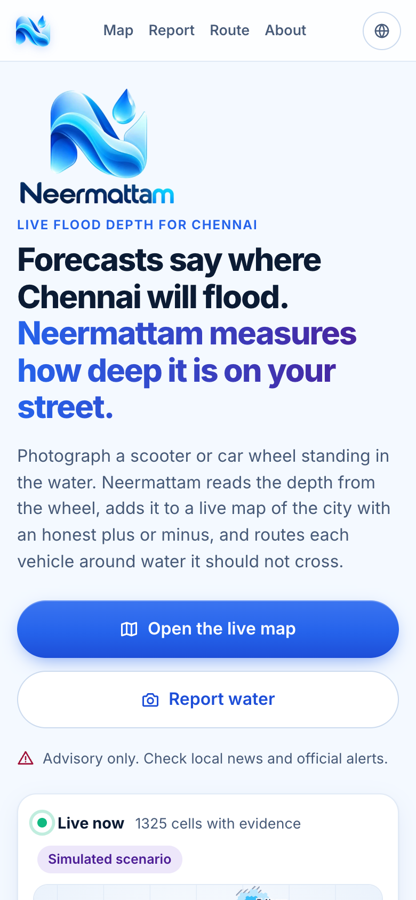 |
| 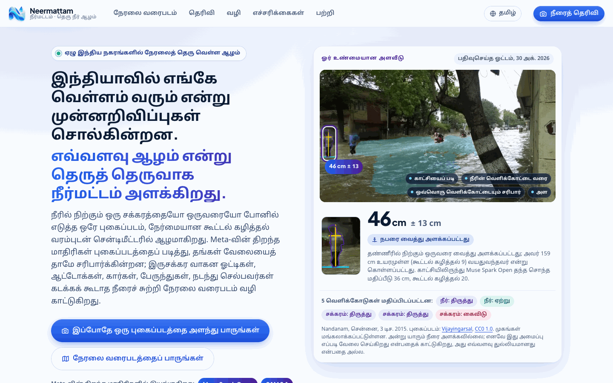 | 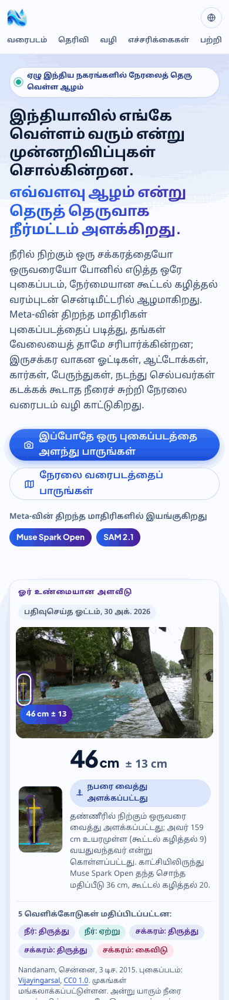 |
| 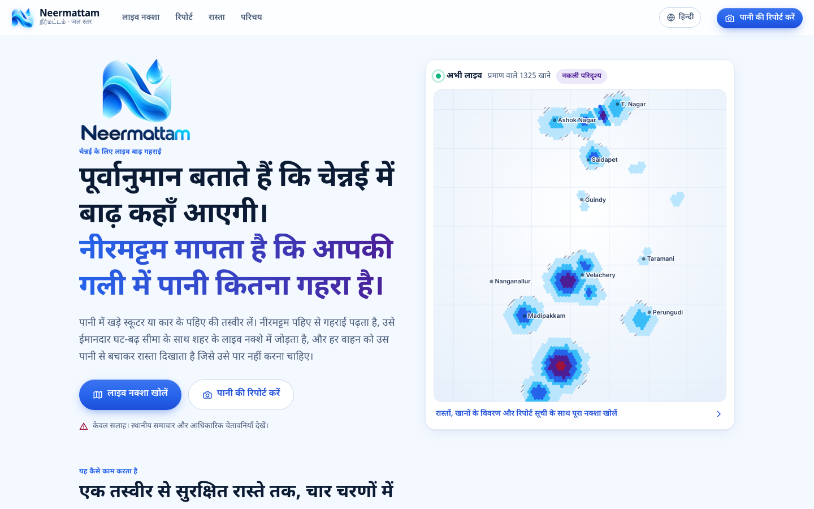 | 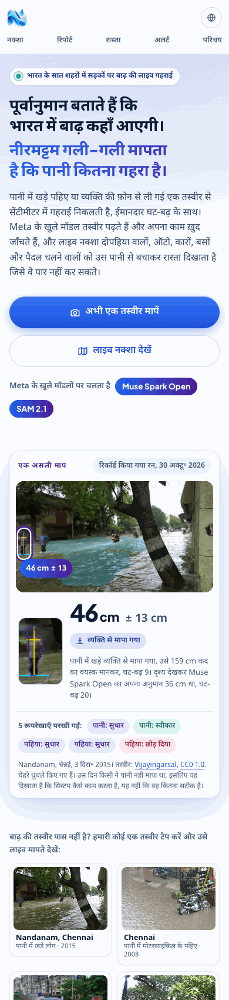 |

The whole English page is in `img/gateway-home-full.png`.

## Languages

Every page, every message the server renders (result cards, verification reasons, errors, the trace, route summaries, durations, months) and the text the inline glue shows are available in English, Tamil, Hindi, Telugu, Kannada, Malayalam, Bengali and Marathi.

- **Catalogues** are Go maps in two files per language: `internal/i18n/messages_<code>.go` for the pages (467 keys) and `messages_<code>_ops.go` for cities, the control room, alerts and the developer page (236 keys), 703 keys each, with English as the reference and the fallback for any missing key. Messages use `fmt` verbs, and `%[2]s` style indexes where a language puts the arguments in another order. Keys ending in `.html` carry a little trusted markup (bold numbers with `data-count` hooks for the live trace); every other message is escaped. Numbers and units stay as numerals (`34 cm`, `0.28 ms`). Place names, model names and model output are not translated.
- **Choice of language**: `?lang=` first (remembered in a one-year `nm_lang` cookie, `SameSite=Lax`, `HttpOnly`), then that cookie, then `Accept-Language` with its q-values, then English. The header has a language menu, a plain `<details>` list of links that keep the current path and query, so it works without script. HTML responses carry `Vary: Cookie, Accept-Language, Accept-Encoding`; static files and the JSON API vary only on encoding.
- **Templates** are parsed once per language at start with the language bound into the `t` and `th` functions, so rendering does no lookups by language. Text for the glue (popups, ticker, ages, errors) is rendered into a `<script type="application/json" id="i18n">` block and read with `NM.tr`.
- **Server-made text** carries a key and arguments as well as its English sentence: verification reasons (`verify.RuleResult.Key`), pipeline errors (`report.Error.Key`), durations and ages. The English page uses the original sentences; other languages build theirs from the catalogue. The engine's route explanation is in English, so for other languages the route summary is rebuilt from the route's own numbers.
- **Fonts.** The system font stack plus Inter for Latin, and Noto Sans Tamil, Devanagari (Hindi and Marathi), Telugu, Kannada, Malayalam or Bengali from Google Fonts, the only external stylesheet, loaded only on pages in that language with `display=optional`. A first visit on a slow link keeps the system font rather than swapping fonts under the reader; later visits use Noto from the cache. The URL is built in Go from the fixed language table, because `html/template` would otherwise escape the `+` in `Noto+Sans+Tamil` to `%2b`, which Google Fonts refuses with a 400. Long-word scripts (Tamil, Malayalam, Telugu, Kannada) get a smaller hero headline and no negative tracking, so the buttons stay above the fold at 1440 by 900 in every language.
- **Tests**: every language has exactly the English keys; every translation keeps its placeholders (compared by argument index) and its markup, and has no em dashes or arrows; every key the templates and code use exists, including keys built at run time; detection order and q-values; and every page renders in every language with the right `lang` attribute, the right font link, the cookie set and no rejected template values.

At 390 pixels the header shows the mark without the wordmark, so the four links and the language button fit in all eight languages with no sideways scroll (checked in headless Chrome: document width 390, language button ending at 376).

## Speed

**Static files** are embedded and served from memory with fingerprinted names: `app.css` is linked as, for example, `app.806ec71c.css` (the first 8 hex digits of its SHA-256, so it changes with the file) with `Cache-Control: public, max-age=31536000, immutable`, an `ETag`, and a gzip copy made at start for text types. The plain name still works with a 5-minute cache. CSS `url()` references to fonts are rewritten to the fingerprinted names. Map pages preconnect to `tiles.openfreemap.org`; pages in an Indic language preconnect to the two Google Fonts hosts.

**Landing page weight**, cold cache: HTML 81 KB (23 KB gzipped), CSS 11 KB, Inter 47 KB, the logo as WebP 15 KB (32 KB on a 2x screen), header mark 8 to 24 KB, about 105 KB on a desktop and 140 KB on a phone, plus the Noto stylesheet for an Indic language. Before this pass it was 371 KB, mostly a 281 KB PNG logo drawn 240 pixels wide and 178 KB of per-cell SVG. The logo, preview and header mark have fixed dimensions, so nothing moves while it loads.

**Measured** with headless Chrome (software rendering, cache disabled) against the local gateway and engine with the 1,325-cell demo map, English, Tamil and Hindi, desktop and phone sizes, 13 loads:

| | Result |
|---|---|
| Cumulative layout shift | 0 in every load |
| Largest contentful paint (the headline or the lead) | 164 to 544 ms, median about 340 ms, excluding the two loads that include Chrome starting (1.3 s for the first desktop load) |
| Load event | 80 to 958 ms; the slowest was Tamil, which waits for the Google Fonts stylesheet |
| Server time for `/` | about 11 ms (curl, warm) |

The machine was running other builds at the time (load average 2 to 3; an earlier attempt at a load average of 17 gave up to 2.5 s), so these show the shape, not a benchmark.

**Fifty map viewers.** `go run ./cmd/loadtest -n 50 -d 60s -pid <gateway pid>` starts 50 simulated viewers over 2 seconds. Each loads `/map` and its eight static files as a first visit, fetches `/api/cells`, holds `/api/stream` open, and revalidates `/api/cells` with its ETag every 15 seconds. The tool samples the gateway's resident memory and CPU time from `ps` once a second. All viewers share one address, so the gateway ran with `API_RATE_PER_MIN=100000 API_BURST=10000` (with the defaults the per-address limiter refuses them, as it should). Local run, 28 October 2026, 8 GB M1 MacBook Air:

| | Demo drip every 6 s (default) | Demo drip every 1 s |
|---|---|---|
| `GET /map` p50 / p95 / max | 11.1 / 42.1 / 123.6 ms | 11.1 / 39.6 / 121.3 ms |
| `GET /api/cells` revalidation p50 / p95 | 0.9 / 73.9 ms | 0.7 / 85.3 ms |
| Static files p95 | 0.3 ms | 0.3 ms |
| Cell events delivered | 3,367 (63 to 70 per viewer) | 20,769 (406 to 420 per viewer) |
| Errors | none | none |
| Gateway memory (RSS) start / mean / peak | 41.7 / 52.1 / 64.3 MB | 44.7 / 45.3 / 65.9 MB |
| Gateway CPU, mean | 2.4 percent of one core | 3.0 percent of one core |

The per-viewer spread in events is viewers joining during the 2-second ramp. Revalidations all return 200 because the demo changes the map faster than the 15-second interval; the p95 is the moment the 2-second cache expires and one viewer waits for the engine query and compression. Concurrent misses for the same area share that one query and one compression (`TestConcurrentCellMissesShareOneQuery`); before that change the first run's `/map` p95 was 229 ms.

The load test found a real bug: the demo's reading ids came from a fixed seed, so a gateway restarted against a running engine replayed ids the engine had already seen, the engine dropped them as duplicates, and the live map stopped moving. Reading ids now mix in a random salt chosen at start; the scenario itself still comes from the fixed seed and looks the same every run (`TestReadingIDsDifferBetweenRuns`).

## Cities

The engine covers Chennai, Mumbai, Bengaluru, Hyderabad, Kolkata and Delhi (docs/ENGINE.md, Cities). The gateway starts from a built-in copy of that list, so pages work before the engine answers, and refreshes it from `GET /v1/cities` every 30 seconds, which adds each city's cell count and routing state (`internal/cities`).

- **Choosing a city.** `/map`, `/route`, `/report`, `/alerts`, `/control` and the landing preview have a city menu (a `<details>` list of links, so it works without script). The choice comes from `?city=`, then the city holding `?at=` (so a WhatsApp link opens the right city), then the `nm_city` cookie, then Chennai; an explicit `?city=` is remembered for a year. Switching city drops `at`, `from`, `to` and `cell` from the link, since they belong to the old city.
- **Scoped data.** The map, landing preview and their glue ask for `/api/cells?city=` and `/api/stream?city=`. The gateway keeps one connection to the engine's stream for every city and filters per browser by each cell's `city` property, so six cities cost no extra upstream connections. The ticker shows the city's own reports.
- **The simulated scenario stays in Chennai.** Only Chennai's map, cells, routes and preview carry `simulated_scenario` and the violet banner. In demo mode a cell with no provenance record reads "simulated" only inside Chennai's box; anywhere else it reads "reported", so another city can never show invented water. A city with no reports says so: "No reports yet in Mumbai. Water shows here as soon as people report it. A street with no reports is unknown, never safe."
- **Routes and reports use the city.** The route form's presets are the city's: five well-known places each, such as Dadar and Andheri stations in Mumbai, Silk Board junction in Bengaluru, Howrah station in Kolkata and ITO in Delhi (`internal/places`). All 60 preset pairs were routed for a car against the engine, 10 of 10 in every city. Both ends must lie in the chosen city; the report pin must lie in the chosen city (or, through the API without a city, in any covered city).
- **Engine errors in plain words**, in the page's language, with a stable `code` in JSON: `different_cities` ("The start and the end are in different cities. A route has to start and end in the same city."), `outside_area` ("The start or the end is outside Mumbai. Pick both points in Mumbai, or switch city."), `routing_unavailable` from the engine's 503 ("Routes in Delhi are not available yet: its road map is still loading. Try again in a minute.", or "could not be loaded" when the graph failed, while the map and reports keep working), `no_road` from its 404. The route page warns before any request when the city's routing is loading or failed.
- **Readiness.** `/readyz` says `degraded`, with the engine's reason, when some city's routing is loading or failed; it stays 200.

| City switcher, desktop | On a phone |
|---|---|
| 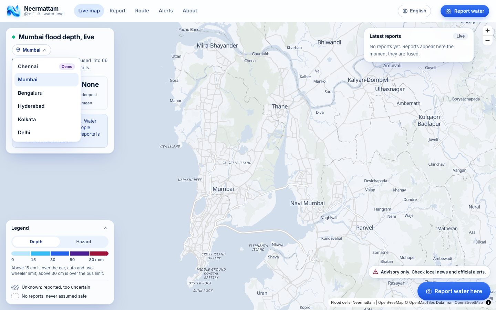 | 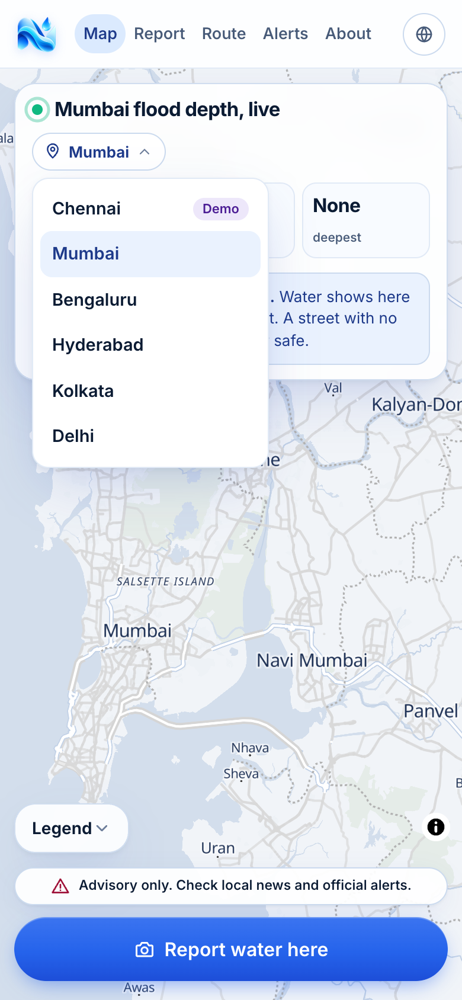 |

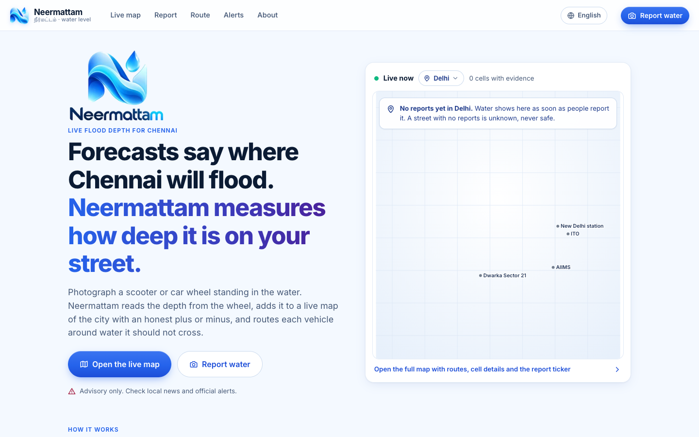

## Control room

`/control` is for ward officers and city control rooms: per city, everything the engine's analytics endpoints know, laid out to be read at a glance.

- **Summary tiles** from `/v1/summary`: cells by hazard class (danger for all, most, some, caution), unknown, stale (6 hours or more, with how many expired), cells in conflict (with conflicting readings), cells needing a fresh report, and the newest reading with the total. Below them, the number of cells closed to each vehicle.
- **Hotspots** from `/v1/hotspots` (top 15): the score out of 100 with a bar split into its four parts (depth 40, hazard 30, freshness 20, reports 10), the blocking depth and the mean plus or minus, the class, age, independent reports, the vehicles the cell is closed to, the reasons, and links to the cell's history and to the map. English shows the engine's own sentences; other languages build theirs from the same parts.
- **Needs a fresh report** from the summary: stale or expired cells last seen deeper than 15 cm, deepest first, each with "Ask for a report" (the report page, pinned there) and its history.
- **Cell history** (`?cell=`) from `/v1/recession`: now, hazard, last update, a conflict marker, and an SVG drawn on the server: each direct reading with its plus or minus, the fused estimate as a line with its band, the 15 cm and 30 cm limits, and the time span. Then the drain rate, its plus or minus and trend, the hours to 15 cm when falling, and the engine's note that it is a straight-line fit of the recent past, not a forecast, and never opens a road. No script and no chart library.
- **Routing by city**: each city's road graph state.
- **Exports**: CSV and GeoJSON buttons pass the engine's `/v1/export` through, with its file name and the `X-Neermattam-Truncated` and `X-Neermattam-Total-Cells` headers.
- **Live.** The page listens to `/api/stream?city=` and, at most every 5 seconds when the city's water changes (and once a minute regardless), fetches the panel re-rendered on the server (`/control/panel`) and swaps it in, keeping any open "why" lists open.

**Access.** Set `CONTROL_ROOM_KEY` (at least 12 characters). `/control` without a session shows a key page; `POST /control/login` compares the key in constant time and sets `nm_ctl`, an HMAC-SHA256 of a fixed label under the key (never the key), `HttpOnly`, `SameSite=Strict`, `Secure` when `PUBLIC_URL` is https, scoped to `/control`, for 12 hours. Changing the key ends every session. Logins are limited to 5 a minute per address. Without `CONTROL_ROOM_KEY` the keyed room is off and the page says so.

**Public demo.** With `DEMO=1`, `/control/demo` is the same room over the simulated Chennai scenario only, read only, with a violet "Public demo with simulated data" banner, so judges can see it without a key. Its panel and exports are rate limited like the public API.

| Control room, desktop | On a phone |
|---|---|
| 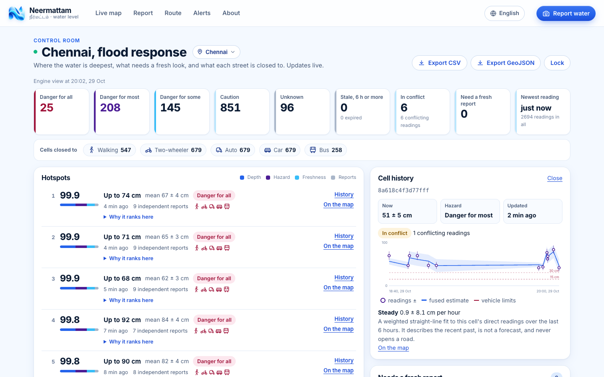 | 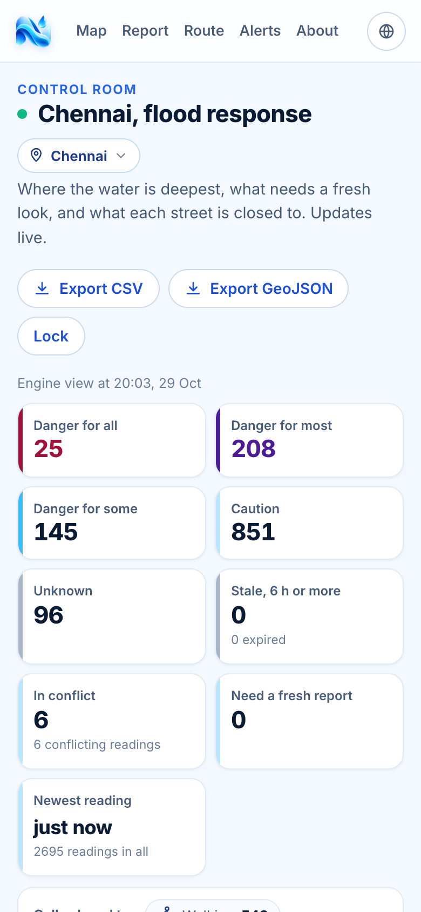 |
| 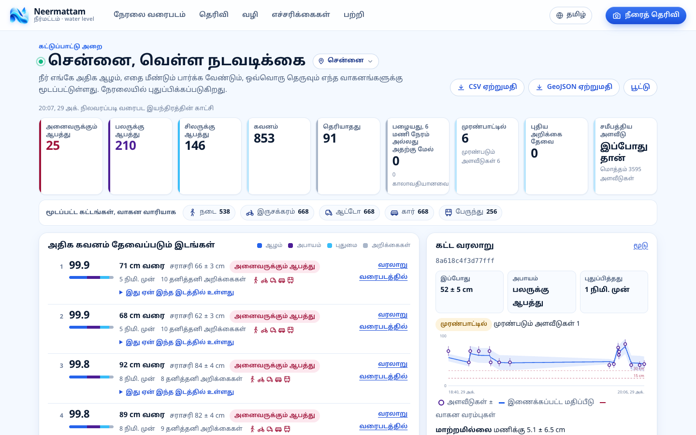 | 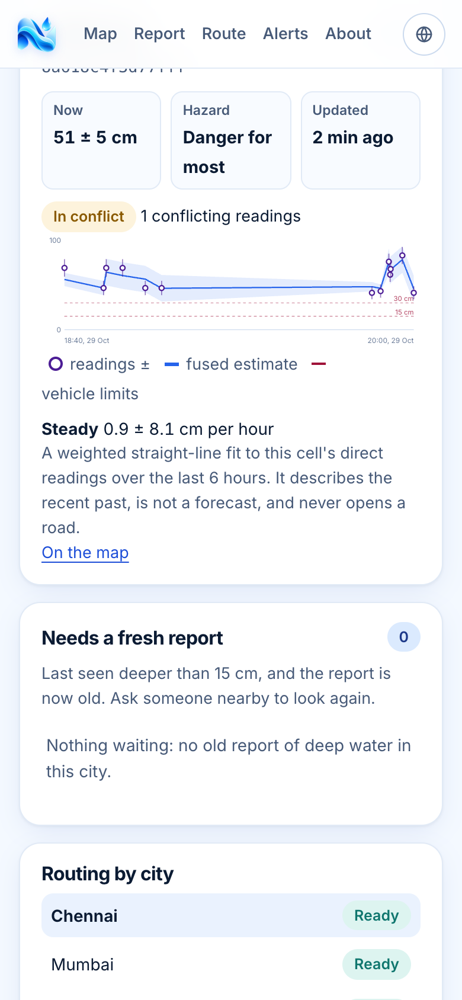 |
| 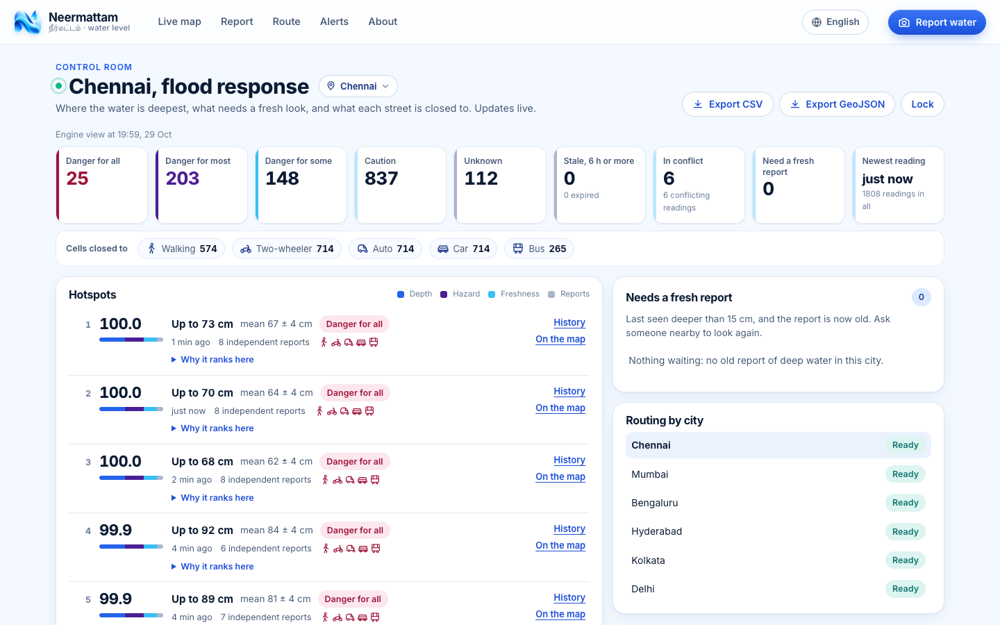 | 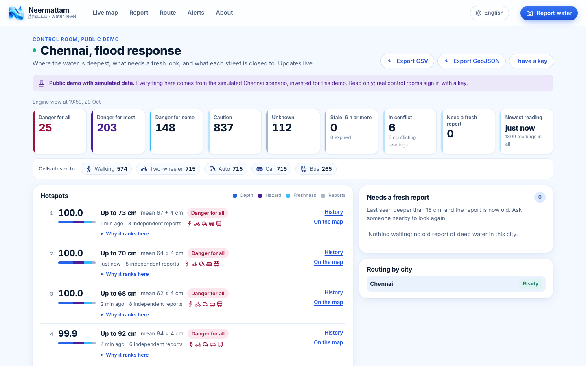 |

## Watch my street

A visitor picks a point on the map, or a route planned on `/route` ("Watch this route"), and a vehicle, and turns on notifications. The gateway sends a message:

- when reports show water there **over the vehicle's limit** (15 cm for two-wheelers, autos and cars, 30 cm for buses, at the blocking depth routing uses; for people on foot, a hazard class of "danger for some" or worse);
- when the hazard there **worsens** a class;
- when the latest reports show it **below the limit again**;
- and, when water that was over the limit is reported no more, that the reports are **out of date** and it should be treated as flooded. Water that ages out is never called clear.

The first message says what is watched and what the water is now ("unknown, not safe" when nobody has reported it). Every message says it is advisory. A route is planned on the server for the chosen vehicle and watched at points every 25 m along it, so water in the middle of a long route is found.

**How it is checked.** `internal/alerts` keeps an index of each watched city's cells (a 0.002 degree grid of cell centres; a point is matched to the hexagon that contains it). Cell events from the engine stream update the index and re-check only the watches near the changed cell; every `ALERT_SWEEP` (2 minutes) each watched city is reloaded and every watch re-checked, which catches water that drains without a new report and cells the engine forgets. Two messages to one watch are at least `ALERT_MIN_GAP` (2 minutes) apart; a change inside the gap is held for the next check.

**Web Push, standard library only.** RFC 8291 message encryption (an ephemeral P-256 key with `crypto/ecdh`, HKDF-SHA-256 with `crypto/hkdf`, AES-128-GCM, one aes128gcm record) and RFC 8292 VAPID (an ES256 JWT signed with `crypto/ecdsa`). No dependency was needed: every primitive is in Go's standard library. A test checks the output byte for byte against the worked example in RFC 8291 section 5; another decrypts what the gateway posts to a fake push service with the subscriber's private key. The VAPID key comes from `VAPID_PUBLIC_KEY` and `VAPID_PRIVATE_KEY`, or is made once and kept in `vapid.json` (mode 0600) in the data directory; `VAPID_SUBJECT` is the contact. Messages go only to the push services of the major browsers (`fcm.googleapis.com`, Mozilla's `push.services.mozilla.com`, `push.apple.com`, `notify.windows.com` and their subdomains; `PUSH_HOSTS` replaces the list), so a subscription cannot make the gateway post to an arbitrary host. A push service's 404 or 410 deletes the watch; five failures in a row end it. `GET /sw.js` is the only file of script besides the vendored MapLibre and inline glue: a short service worker that shows the notification and opens its link, and nothing else. On iPhones, Safari delivers web push only to web apps added to the home screen; the page says so.

**Storage and limits.** Watches are kept in `alerts.json` (mode 0600) in the data directory, saved every few seconds when changed. Each holds the place, vehicle, city, language, the push endpoint and keys (or the WhatsApp number), the last state, and a SHA-256 of the token that reads or deletes it. A watch ends after `ALERT_TTL` (14 days). At most `ALERTS_PER_CLIENT` (10) per browser or number and `ALERTS_MAX` (5,000) in all. The browser keeps the ids and tokens of its own watches in `localStorage`, and the page lists them with their current state and a Stop button.

**WhatsApp**, the same watcher. With the WhatsApp variables set, `watch` (or `watch car`, `watch bus`, `watch auto`, `watch walking`) followed by a shared location watches that point; `stop` ends every watch for the number. Messages are plain text with the same wording and a link. WhatsApp only delivers free-form business messages within 24 hours of the person's last message; outside that window Meta requires a pre-approved template, which this gateway does not send, so a long-lived WhatsApp watch can go quiet. Web Push has no such limit.

| Desktop | On a phone |
|---|---|
| 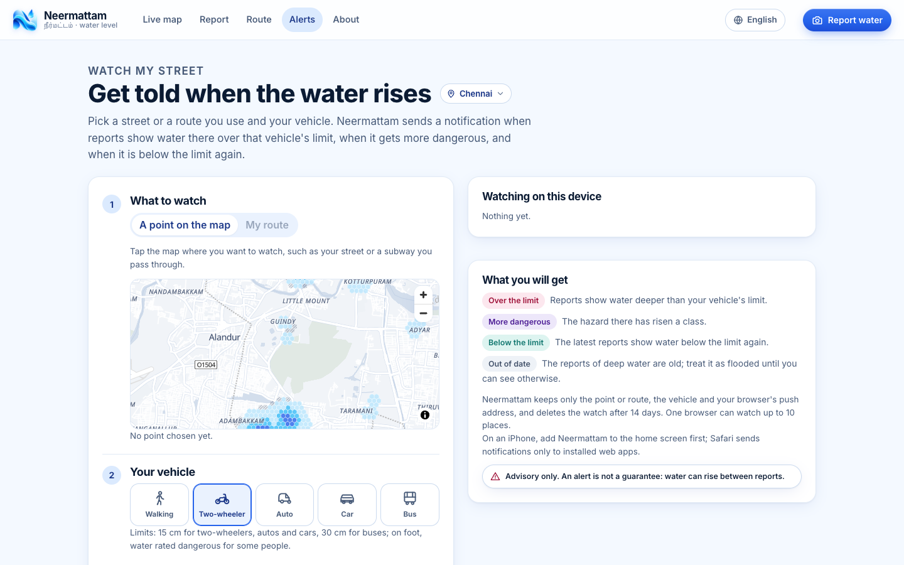 | 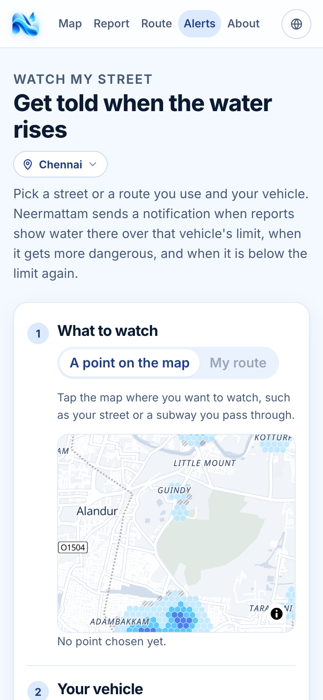 |

## Developer API

For fleets and apps, with a key per customer: `GET /api/v1/route`, `GET /api/v1/cells` and `GET /api/v1/usage` (contract in docs/CONTRACTS.md section 3, documentation for customers at `/developers`). Answers are the public API's plus top-level `"advisory": true` and a `terms` link.

- **Keys.** `go run ./cmd/neermattam-keys create -name "Acme Fleet" -rate 600` makes a key `nm_live_` plus 32 base32 characters (160 random bits), prints it once, and stores only its SHA-256, the first 8 characters as its public id, the name, the rate and whether it is disabled, in `apikeys.json` (mode 0600) in the data directory. `list`, `usage [id]`, `disable`, `enable` and `delete` manage them. The gateway re-reads the file within 2 seconds of a change, so a new or disabled key needs no restart. The CLI is the file's only writer.
- **Authentication.** `Authorization: Bearer <key>` or `X-API-Key`. The hash is compared in constant time, against a dummy for unknown ids. 401 `missing_key` or `invalid_key`, 403 `key_disabled`.
- **Limits.** A token bucket per key at its own rate per minute, with a burst of ten seconds' worth (at least 5). Every answer carries `X-RateLimit-Limit` and `X-RateLimit-Remaining`; a 429 `rate_limited` carries `Retry-After`.
- **Usage for billing.** Each returned route and each cells read is counted per key and per UTC day (a failed route is not counted), kept for 90 days in `apikey-usage.json`, which only the gateway writes (every 30 seconds and at shutdown). A customer reads its own counts at `/api/v1/usage`; the operator reads everyone's with `neermattam-keys usage`. Pricing is agreed with the operator; nothing on the page invents a price.
- **Terms**, on the page: every route and depth is advisory and must be shown as such; unknown is not dry; depths carry uncertainty; `simulated_scenario` answers are invented and must not be used for real decisions; OpenStreetMap attribution; no guarantee of availability or accuracy.

Checked against the running gateway: no key 401, a made-up key 401, a 6-a-minute trial key refused with 429 after its burst of 5, the 600-a-minute key served routes and cells with the headers, usage counted, and a key disabled with the CLI answered 403 within 3 seconds.

| Desktop | On a phone |
|---|---|
| 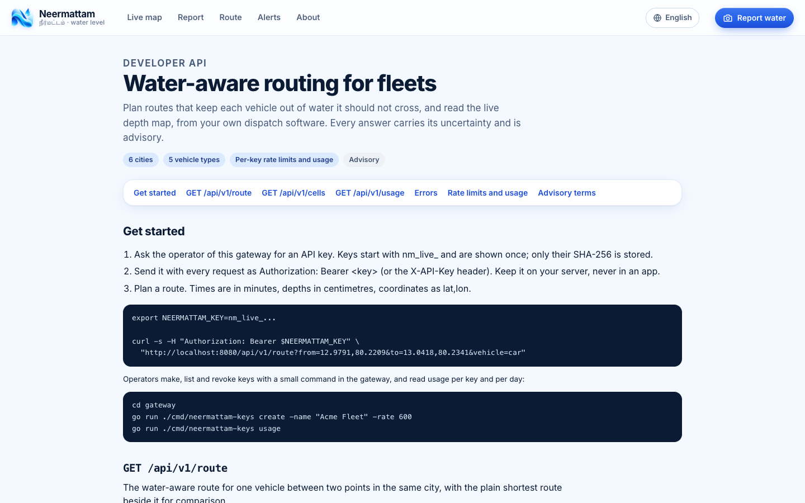 | 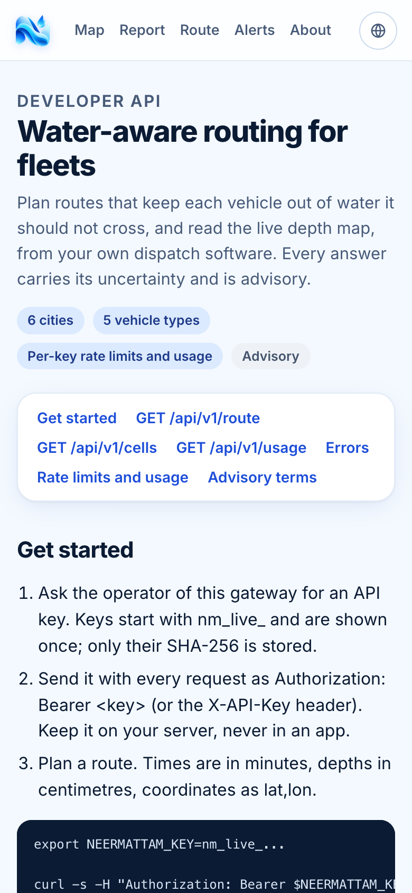 |

## Request path

```
browser or WhatsApp
  |
  gateway
  |  1. per-IP token bucket
  |  2. stream the multipart body, holding at most the largest allowed file
  |  3. sniff the bytes (never the client's Content-Type), apply size and length limits
  |  4. SHA-256 and perceptual hash: refuse a file already reported
  |  5. POST /v1/measure or /v1/transcribe to perception
  |  6. verification rules, giving trust in (0, 1]
  |  7. POST /v1/readings to the engine
  |  8. label the cell as real, tell the live map, reply
```

The same `report.Pipeline` runs for `POST /api/report` (JSON), `POST /report` (the page) and WhatsApp.

**Limits.** Photos up to 12 MB and 50 megapixels (checked from the header before decoding), videos up to 40 MB and 30 seconds (read from the MP4 or QuickTime `mvhd` box), voice notes up to 8 MB. Accepted types are found from magic bytes: JPEG, PNG, MP4, MOV, Ogg, WAV and M4A. HEIC and WebP get a message asking for a JPEG or PNG. The whole body is capped with `http.MaxBytesReader`.

**Rate limits.** A token bucket per client IP: reports 6 per minute with bursts of 4, API reads 120 per minute with bursts of 40. A refused request gets 429 with `Retry-After`. `X-Forwarded-For` is honoured only with `TRUST_PROXY=1`.

**Method.** Perception says how it got the depth. `wheel_geometry` is shown as "Measured from a two-wheeler wheel" (or car or auto wheel). `model_estimate` gets a violet "Model estimate" badge, a note that no wheel could be measured and what the model based its estimate on, and the wide band drawn hatched on the depth gauge. When a measurement comes with the model's own estimate, the card shows both readings and draws the estimate as a second band; the measurement is the one fused.

**Capture time.** The gateway uses perception's `captured_at` (read from EXIF before perception strips metadata). An RFC 3339 time with a zone is used as is; a time without an offset is read as India Standard Time. A null `captured_at` means the photo has none. Only when the field is missing altogether (an older perception) does the gateway read EXIF itself.

**Voice notes.** An Ogg, WAV, M4A or MP3 voice note goes to `/v1/transcribe`. The page shows the transcript, the place said, the depth words, the language and the model. The depth is the voice model's own reading when it gives one, with sigma at least 10 cm or 30 percent; otherwise the gateway reads the depth words itself. The reading is fused with source `voice` at the map pin, never at the place said, since nothing geocodes it.

**Overlay.** Perception's overlay arrives as a base64 PNG, often 1 to 2 MB, which made a report reply about 1.9 MB and took 137 seconds to reach a phone against 47 seconds of server time. The gateway now decodes it, flattens it onto white, shrinks it to at most 1280 pixels on the long side by area averaging, and encodes it as a JPEG at quality 82, all with the Go standard library. The JPEG is kept for an hour in a bounded in-memory LRU (300 overlays or 96 MB) and served from `GET /api/overlay/{measurement_id}`; the reply carries `overlay_url` instead of the base64. A test checks that a reply with a multi-megabyte overlay stays under 30 KB.

**Duplicates.** The exact bytes (SHA-256) and the 64-bit difference hash of each photo are kept for 24 hours. An exact copy, or a photo within 5 bits of an earlier one (a re-encode, resize or screenshot), is refused with 409. Fusing the same water twice would make the engine overconfident. The reading id sent to the engine is derived from the SHA-256, so a retry is also ignored by the engine.

**Progress and the agent trace.** `POST /report` with `Accept: text/event-stream` answers with server-sent events (the browser posts the form and reads the response, because `EventSource` cannot upload a file):

- `stage`: `{"stage": "received" | "scene" | "verify" | "fuse"}`, sent as the pipeline reaches each stage;
- `step`: one step of perception's agent the moment perception reports it, as a timeline item rendered on the server, `{"html", "tone", "index"}`;
- `done` (or `error`): the result card and the complete trace panel, both rendered on the server.

For photos and videos the gateway calls `POST /v1/measure/stream` and passes each step through. The gateway expects that stream to send `event: step` with one `agent_trace` entry, then `event: result` with the full `/v1/measure` response, or `event: error` with `{"detail", "status"}`; unnamed events are recognised by their shape and a plain JSON answer is accepted as the result. When perception answers 404, 405 or 501 the gateway falls back to `/v1/measure` and remembers that for five minutes, so an older perception costs one probe, not a second upload per report. In that case the page shows a waiting row, and the whole trace appears with the result and is revealed step by step. The page shows a live clock on the active stage and the recorded latency of every step; it never animates progress it does not have.

The trace panel draws each step on a vertical timeline: read the scene, segment, verify or confirm, refine (a check that sent SAM a corrected box), give up, geometry and estimate, each with its target, model, output, decision, input and wall time, plus counts of accepted, refined and abandoned masks and the models involved. The summed model time is labelled as a sum, because perception runs checks in parallel.

**Concurrency.** At most 8 reports are measured at once (`MAX_INFLIGHT_REPORTS`); the next gets 503 with a message to retry.

## Verification

Package `internal/verify`. Each rule returns an outcome (`pass`, `lower`, `reject` or `skip`), a factor and a reason a person can read, and is logged and counted in `/metrics`. Trust is the product of the factors, clamped to 0.05 to 1, and is sent to the engine, which divides the reading's variance by it (`R = sigma^2 / trust`, see ENGINE.md). Only two rules can reject. Everything else lowers trust, because an unusual report can be the first sign of real water.

| Rule | Outcome | Rationale |
|---|---|---|
| **Confidence floor** | Measurements: reject below 0.35; between 0.35 and 0.6, trust is scaled by confidence / 0.6. Model estimates: reject below 0.15, otherwise pass. | A measurement the model itself doubts should not move the map. Perception keeps an estimate's confidence low on purpose (0.21 to 0.23 on the real photos in `eval/RESULTS_REAL.md`); its weight is already cut by a sigma of at least 20 cm and by the source rule, so scaling again would count the same doubt twice, and the old floor would have discarded every estimate. Voice notes have no model confidence and skip this rule. |
| **Photo freshness** | From EXIF `DateTimeOriginal` (with `OffsetTimeOriginal` when present, otherwise read as IST). Up to 2 h old: pass. 2 to 6 h: 0.8. 6 to 24 h: 0.5. Over 24 h: reject. Clock more than 15 minutes ahead: 0.6 and the arrival time is used. No EXIF: 0.9 and the arrival time is used. | Water changes within hours. An old photo is fused at the time it was taken, so the engine's decay ages it correctly. WhatsApp strips EXIF, so its absence is only a small penalty. The engine refuses readings over 24 hours old anyway. |
| **Source** | Voice: 0.6. Model estimate: 0.7. Measured photo or video: pass. | A spoken "knee deep" is a rough estimate, and a visual estimate is not a measurement. With a 20 cm sigma an estimate alone leaves a cell `unknown` in the engine, which is right. |
| **Neighbour agreement** | Known engine cells within 300 m, excluding any cell touched by simulated readings, are combined by inverse variance, with 5 cm of extra spread per 100 m of distance. More than 3 standard deviations away: 0.4. 2 to 3: 0.75. Otherwise pass. No cells: skip. | Strong disagreement is suspicious but not proof: a subway can hold a metre of water 100 m from a dry road. Lowering trust lets the filter weigh it without discarding a true first report. |
| **Rainfall plausibility** | Modelled hourly precipitation for the 48 hours before the observation, from the Open-Meteo forecast API (which serves the past days too). Depth over 10 cm with under 1 mm of rain: 0.6. Otherwise pass. API unavailable: skip. | Deep water on a dry day is unusual, but reservoir releases, burst mains and tides do flood Chennai streets, so it is never a rejection. |

The thresholds are engineering judgements, not values fitted to data; they live in `verify.DefaultThresholds`. Open-Meteo is called without a key under its free non-commercial terms (fewer than 10,000 calls a day, CC BY 4.0 attribution on the About page). Each fetch covers a 0.05 degree square for 30 minutes, so a busy evening costs a handful of calls.

When the voice model gives no depth, words such as "ankle", "knee" or "waist" (and a few Tamil equivalents), or an explicit "30 cm" or "2 feet", become a depth with deliberately wide uncertainty (for example knee: 45 cm plus or minus 8, from assumed adult proportions). No depth at all means the report is unusable.

## Live map and the cell proxy

`GET /api/cells` proxies `/v1/cells` for the whole service area (or a `bbox`), caches each answer for 2 seconds, and serves it gzipped at the best ratio with an `ETag`; a matching `If-None-Match` gets 304 with no body. A crowd opening the map costs the engine one query every 2 seconds: requests that miss the cache together wait for one shared fetch, which is not cancelled when the request that started it goes away.

The payload is compacted for the map: coordinates are rounded to 5 decimals (about a metre, against a 66 m cell), and only the fields the map and its popup use are kept (depth, sigma and upper estimate, velocity and its sigma, whether velocity was assumed, hazard rating and class, unknown, report counts, update time, origin). Debris factor, the upper hazard class and the duplicate top-level id stay in the engine's API. Measured locally with the 1,325-cell demo map:

| | Plain | Gzipped |
|---|---|---|
| Engine `/v1/cells` | 955,803 bytes | |
| Gateway before this change | 982,051 bytes | 115,026 bytes |
| Gateway now | 691,283 bytes | 59,375 bytes |
| Revalidation with a matching ETag | 0 bytes, 304 | |

**First paint.** The map page carries the same cells inline, as a JSON script element rendered on the server from the 2-second cache, so the hexagons need no second round trip; the HTML is gzipped (about 92 KB with the demo map). The cells are added as soon as the base style is parsed, before its tiles arrive, and a loading veil over the map lifts the moment they are drawn. The page then opens the live stream and revalidates the cells in the background, usually a 304. Measured with headless Chrome (software rendering, cache disabled) against a local engine, as the time until the first cells are drawn:

| | Local | Throttled: 250 ms latency, 5 Mbit/s |
|---|---|---|
| Before (fetch after map load) | 3.5 to 7.6 s | 6.1 to 6.2 s |
| Now (inline, at style load) | 1.6 to 1.9 s to the veil lifting | 3.4 to 4.0 s |

The rest is MapLibre and the base map, which come from OpenFreeMap. These are two runs each on one machine; they show the direction, not a benchmark.

**Style warnings.** Every value the map's own layers read from a cell is coalesced, and the base style's numeric filters that test fields many tiles lack (road shields compare `ref_length`) are rewritten at load so a missing number fails the comparison quietly, as intended, instead of logging "Expected value to be of type number, but found null" for every tile.

`GET /api/stream` is served from one upstream connection to the engine's `/v1/stream`, reconnected with capped backoff. Up to 200 browsers can subscribe (`MAX_SSE_CLIENTS`); the next gets 503 with `Retry-After`. Each browser has a 256-event buffer; one that falls behind is disconnected, and its `EventSource` reconnects and refetches. Events:

- `cell`: a changed cell, as the engine sends it, plus `properties.origin`.
- `report`: a new report for the ticker.
- `resync`: refetch `/api/cells` (after an engine reconnect or when the engine says it dropped events).
- `hello`, and a comment ping every 20 seconds.

`GET /api/route` proxies `/v1/route`, accepting `walking` as an alias for `pedestrian`. The route and its `baseline` member pass through unchanged, with `simulated_scenario: true` added when the map holds simulated water.

## Demo mode

`DEMO=1` seeds the engine with a simulated flood: twelve pools of water at low points that flooded during Cyclone Michaung in December 2023 (Ram Nagar and Vijayanagar in Velachery, Velachery Main Road, Pallikaranai, the Madley Road subway, Usman Road, West Mambalam, Saidapet by the Adyar, Madipakkam, Ashok Nagar, Perungudi), a few dry streets, and a few vague reports that the engine rates unknown. About 850 readings go in at start. The depths are invented. A new simulated reading arrives every 6 seconds with the water slowly rising and falling, so the live map visibly changes, and the whole scenario is refreshed every 30 minutes so it does not decay away.

Simulated and real evidence are never mixed unlabelled:

- Simulated readings have ids starting with `sim_` and no `source`. The ids include a random salt chosen when the gateway starts, so a restarted gateway is not deduplicated by an engine that kept running.
- The gateway labels every cell it serves as `simulated`, `reported` or `mixed`. The engine streams a reading's seven changed cells before the gateway sees its response, so before each post the gateway registers a 160 m zone around the point for 15 seconds, and a streamed cell whose centre falls inside is labelled from it.
- The map shows a "Simulated scenario" banner, outlines real cells, tags the ticker, and the popup, result card and route summary all say when simulated water is involved.
- Verification never compares a real report with simulated cells.

### Provenance survives restarts

Labels come from an explicit record, never from what happens to be in the engine when the gateway starts, so the engine's snapshot can be kept across restarts and real reports keep their label:

- A simulated reading has an id starting `sim_`. After each seed the gateway reads the whole map once and marks every cell within 160 m of a simulated reading (its own cell and the ring of six) as simulated; each drip marks the cells around it.
- A real report is recorded when the engine fuses it: reading id, cell, place, depth, sigma, source, trust, capture and arrival time. Its cell and the ring around it are marked real. A `sim_` id is never recorded as real.
- Both sets and the records are saved to `provenance.json` in `GATEWAY_DATA_DIR` (default `../data/gateway`; empty turns persistence off). Saves happen at most every 3 seconds when something changed, and once at shutdown, through a temporary file and a rename, so a crash never leaves half a file. A file that cannot be read is moved aside and the gateway starts with an empty record.
- Entries older than 48 hours are dropped, matching the engine, which forgets cells after 48 hours without evidence. At most 2,000 real reports are kept.
- After a restart the real reports reappear in the live ticker, and their cells read `reported` or `mixed`.
- In demo mode a cell with no record at all reads `simulated`, so a gap in the record can only ever understate real evidence, never pass simulated water off as real. Without demo mode such a cell reads `reported`.

On Modal, point `GATEWAY_DATA_DIR` at a Volume so the record outlives the container.

## WhatsApp

`/webhooks/whatsapp` is enabled only when `WHATSAPP_VERIFY_TOKEN`, `WHATSAPP_APP_SECRET` and `WHATSAPP_TOKEN` are all set; otherwise both methods answer 404 and the start-up log names the missing variables (never their values).

- `GET` answers Meta's handshake when `hub.verify_token` matches (constant-time compare).
- `POST` checks `X-Hub-Signature-256` as HMAC-SHA256 of the raw body with the app secret, compared with `hmac.Equal`, before parsing anything. A bad or missing signature gets 401.
- Image, video, audio and location messages are read. A media message waits up to 10 minutes for a location from the same sender, or the reverse. Redelivered message ids are ignored.
- Media is fetched from the Graph API (`/{media-id}` for the URL, then the file, both with the bearer token and the same size limits), run through the same pipeline, and answered with a plain-text result such as "Neermattam measured about 34 cm of water near Velachery (plus or minus 4 cm), using a two wheeler wheel as the ruler. Confidence 0.82. ... Advisory only." A model estimate is called an estimate in the reply, and a voice note a rough spoken estimate.
- The webhook answers 200 at once and works in the background, at most 4 reports at a time.

## Operations

- `GET /healthz`: 200 while the process runs.
- `GET /readyz`: 200 only when the engine and perception both answer their `/readyz`; otherwise 503 with each one's state, plus whether the engine stream is connected and whether WhatsApp is enabled.
- `GET /metrics`: Prometheus text format from a small built-in exporter (`internal/metrics`; the official client would add a dozen modules for counters, gauges and histograms). Requests by route and status, request and upstream latency, report outcomes, verification rule outcomes, trust, rate-limit refusals, cache hits, live clients and dropped clients.
- Logs are JSON from `log/slog`: one line per request (method, route pattern, status, duration, bytes, never client addresses), one per verification rule and one per report. Tokens and secrets are never logged.
- Timeouts: engine 5 s, routes 20 s, perception 240 s (a photo with wheels to check took up to 110 s in `eval/RESULTS_REAL.md`), Open-Meteo 4 s, Graph API 30 s, request headers 10 s. Every non-streaming reply, and reading the request body, must finish within `REPLY_DEADLINE` (default 4 minutes 30 seconds) of the request starting; the gateway refuses to start if that is not longer than the perception timeout. The live stream has no deadline.
- Shutdown on SIGINT or SIGTERM closes the live streams, drains requests for up to 15 seconds and lets WhatsApp replies finish.

## Brand

The logo is the user's design: `gateway/brand-src/neermattam-logo-original.png` (1254 by 1254). `gateway/brand-src/make_brand.py` (Python with Pillow and NumPy: `cd gateway/brand-src && uv run --with pillow --with numpy python make_brand.py`) makes every derivative in `internal/web/static/brand/`:

- the mark alone, the wave N and the drop with the background removed, at 64, 128 and 512 pixels. The backdrop is removed by growing a region from the image border across the smooth light-blue background; the artwork's edges stop it, so pale parts of the N survive;
- `favicon.ico` (16, 32 and 48), `favicon-32.png` and a 180-pixel `apple-touch-icon.png` on the theme background;
- `logo-full.png`, the mark and wordmark, shown on the About page, and `logo-240.webp` and `logo-480.webp` from the same crop for the landing page (15 KB and 33 KB against the PNG's 281 KB);
- `og-card.png`, a 1200 by 630 Open Graph card with the tagline "Street-level flood depth for Chennai, from one photo" and the depth scale.

The header shows the mark (64 or 128 pixels for high-density screens) beside the "Neermattam / நீர்மட்டம் · water level" text, the second line translated into the page language; below 480 pixels the mark stands alone. Every page links the favicons and carries Open Graph and Twitter card tags; the image URL is built from `PUBLIC_URL`, so set that to the public address.

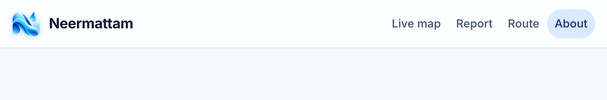

## Configuration

| Variable | Default | Meaning |
|---|---|---|
| `GATEWAY_ADDR` | `:8080` | Listen address |
| `PUBLIC_URL` | `http://localhost:8080` | Used in WhatsApp replies |
| `ENGINE_URL` | `http://127.0.0.1:8302` | Engine |
| `PERCEPTION_URL` | `http://127.0.0.1:8301` | Perception |
| `OPEN_METEO_URL` | `https://api.open-meteo.com` | Rainfall API |
| `ENGINE_TIMEOUT`, `ROUTE_TIMEOUT`, `PERCEPTION_TIMEOUT`, `WEATHER_TIMEOUT` | `5s`, `20s`, `240s`, `4s` | Upstream timeouts |
| `REPLY_DEADLINE` | `4m30s` | Deadline for every non-streaming reply, from the start of the request |
| `GATEWAY_DATA_DIR` | `../data/gateway` | Where `provenance.json`, `alerts.json`, `vapid.json`, `apikeys.json` and `apikey-usage.json` are kept; empty disables persistence |
| `CONTROL_ROOM_KEY` | empty | Unlocks `/control` (at least 12 characters); empty leaves only the public demo |
| `ALERTS` | `true` | "Watch my street" |
| `ALERTS_MAX`, `ALERTS_PER_CLIENT` | `5000`, `10` | Watches in all, and per browser or WhatsApp number |
| `ALERT_TTL`, `ALERT_MIN_GAP`, `ALERT_SWEEP` | `336h`, `2m`, `2m` | Watch lifetime, least time between two messages to one watch, full re-check interval |
| `VAPID_PUBLIC_KEY`, `VAPID_PRIVATE_KEY` | empty | Web Push key pair (base64url); empty makes one and keeps it in `vapid.json` |
| `VAPID_SUBJECT` | `PUBLIC_URL` if https, else `mailto:alerts@localhost` | Contact sent to push services |
| `PUSH_HOSTS` | the major browsers' push services | Comma-separated hosts push messages may go to |
| `REPO_ROOT` | `..` | Where the landing page reads its numbers live (`docs/`, `eval/`); the embedded copy is used when they are absent |
| `GATEWAY_BBOX` | `80.10,12.85,80.33,13.24` | The simulated scenario's area (Chennai); the covered cities come from the engine |
| `MAX_IMAGE_BYTES`, `MAX_VIDEO_BYTES`, `MAX_AUDIO_BYTES` | 12 MiB, 40 MiB, 8 MiB | Upload sizes |
| `MAX_VIDEO_SECONDS` | `30` | Video length |
| `MAX_IMAGE_PIXELS` | `50000000` | Decompression bomb guard |
| `REPORT_RATE_PER_MIN`, `REPORT_BURST` | `6`, `4` | Report rate limit per IP |
| `API_RATE_PER_MIN`, `API_BURST` | `120`, `40` | Read API rate limit per IP |
| `TRUST_PROXY` | `false` | Honour `X-Forwarded-For` |
| `MAX_INFLIGHT_REPORTS` | `8` | Reports measured at once |
| `MAX_SSE_CLIENTS` | `200` | Live map connections |
| `CELLS_CACHE_TTL` | `2s` | Cell proxy cache |
| `DUPLICATE_WINDOW`, `NEAR_DUPLICATE_BITS` | `24h`, `5` | Duplicate detection |
| `DEMO` | `false` | Simulated scenario |
| `DEMO_DRIP_INTERVAL`, `DEMO_RESEED_INTERVAL` | `6s`, `30m` | Demo pacing |
| `WHATSAPP_VERIFY_TOKEN`, `WHATSAPP_APP_SECRET`, `WHATSAPP_TOKEN` | empty | All three enable the webhook |
| `WHATSAPP_PHONE_NUMBER_ID` | empty | Sender for replies (taken from the webhook when empty) |
| `WHATSAPP_GRAPH_URL` | `https://graph.facebook.com/v23.0` | Graph API base |
| `LOG_LEVEL` | `info` | `debug`, `info`, `warn`, `error` |

## Running

Locally, next to the engine:

```sh
cd engine && ENGINE_SNAPSHOT_PATH=/tmp/neermattam-demo-cells.json cargo run --release &
cd gateway && DEMO=1 go run ./cmd/neermattam-gateway
# open http://localhost:8080 (landing) or http://localhost:8080/map
# a language: http://localhost:8080/?lang=ta
```

With Docker (the OSM extract must be at `data/osm/chennai-roads.osm.pbf`; see ENGINE.md):

```sh
DEMO=1 docker compose up --build
```

`docker-compose.yml` builds all three services. Only the gateway publishes a port; the engine sits on an internal network with no internet access, the extract is mounted read-only, and the engine's snapshot lives in a named volume. `gateway/Dockerfile` runs the tests, builds a static binary and ships it on `distroless/static` as a non-root user. `engine/Dockerfile` builds the release binary and ships it on `distroless/cc`. Perception is built from an inline Dockerfile that copies only its project files and sources.

## Tests

```sh
cd gateway
go test ./...
go vet ./...
gofmt -l .
go generate ./internal/facts   # after ENGINE.md, GEOMETRY.md or RESULTS_REAL.md change
```

The tests use `httptest` fakes for the engine (including its SSE stream) and perception, a fake Graph API and a fake rainfall source. They cover a fixed clock for every check of capture times (no test depends on today's date), the overlay re-encode and its LRU, a report reply under 30 KB with a multi-megabyte overlay, compact cells with ETag and 304, the cells inlined in the map page, provenance surviving a restart in demo mode, the stage and live step events in order, the fallback when perception has no stream (and that it is probed once), the model-estimate card and its trust, both readings beside a measurement, perception's `captured_at` winning over the photo's own EXIF and an explicit null meaning none, voice reports end to end with a Tamil transcript, trace step classification, upload limits (size, video length, missing header, disguised files, location, area), rate limiting and `Retry-After`, exact and near duplicates, the full report path with the reading the engine receives, the NDJSON stages, every verification rule, Open-Meteo summing and caching, WhatsApp signatures (good, tampered, missing, wrong secret), the handshake, pairing and the pairing window, template rendering of every page (no rejected values, no em dashes or arrows, every inline script carrying the CSP nonce) and of every page in all eight languages (`lang` attribute, font link, language cookie), the translation catalogues (every key in every language, placeholders and markup kept, every used key defined, language detection), the landing numbers matching the documents they come from, concurrent cell-cache misses sharing one engine query, demo reading ids differing between runs, the cell cache and origin labels, the city switcher (cookie, `?at=`, presets, Mumbai empty and never simulated, the API scoped by city), route errors in plain words in English and Tamil, the control room (key page, wrong and right key, the session cookie's flags, panel, export pass-through, the history drill-down against the engine's real recession shape, the labelled public demo, the room off without a key), the developer API (missing, invalid and disabled keys, picking up a new key file, the advisory wrapper, ETag, per-key limits with Retry-After, usage counted and saved, failed routes not counted), the alerts API (foreign endpoints refused, points outside the city refused, create, token, route watches planned on the server, delete), Web Push encryption against RFC 8291's example and a VAPID JWT that verifies, a watch going over, worse, clear and out of date with every message decrypted and marked advisory, a sweep catching drained water, a gone subscription dropped, route sampling, store caps and persistence, the WhatsApp watch and stop commands, the SSE fan-out with its client limit and resync, readiness, metrics format, gzip of static files, MP4 duration parsing, EXIF capture times and the demo scenario's validity.
