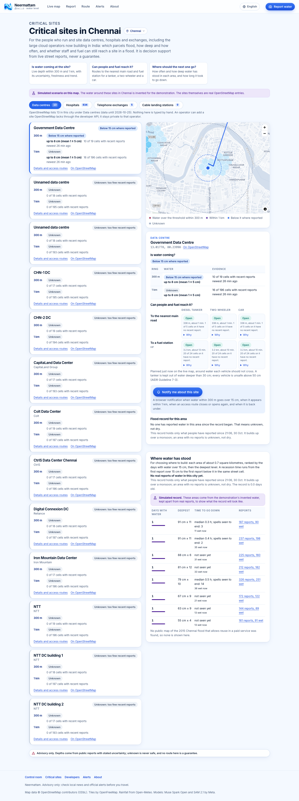
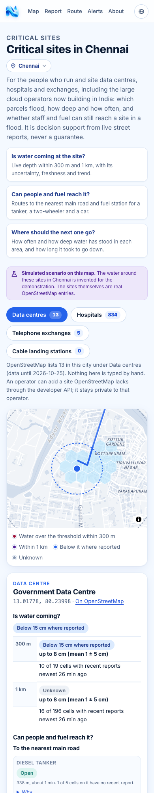
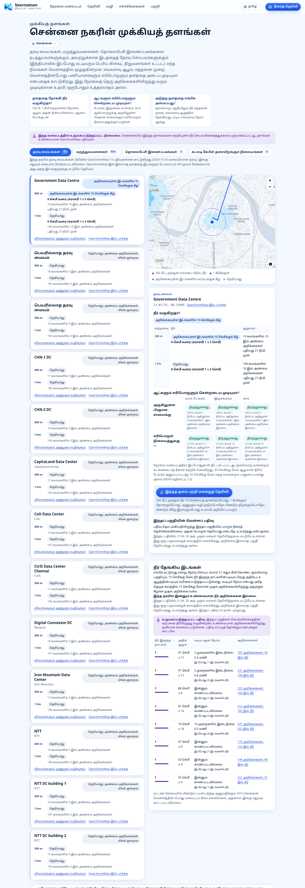

# Critical sites

Neermattam's "Critical sites" view is for the people who run and site data centres, hospitals and telephone exchanges. A data centre in a flood has three questions, and Neermattam answers each one from what it already measures:

1. **Is water coming at the site?** The live fused depth within 300 m and 1 km of it, with its uncertainty, how fresh the evidence is, whether the level is rising or falling, and "unknown" where the evidence is thin.
2. **Can people and supplies still reach it?** Water-aware routes from the site to the nearest main road and to the nearest fuel station, for a diesel tanker, a two-wheeler and a car, each open, open with a detour, or with no safe route.
3. **Where should the next one be built?** For each area of about 0.7 square kilometres, how often water stood there, how deep, and how long it took to go down, from a record that builds up over a monsoon.

For a siting or operations team the question is: which parcels flood, how deep and how often, and can we reach the site in a flood. Everything here is decision support from public street reports. It is advisory, it is never a guarantee, and "unknown" is never "safe".

Data centres come first. Hospitals and telephone exchanges use the same model and are already listed; substations and cable landing stations have a kind in the model and appear as soon as there is data for them.

| Desktop | On a phone |
|---|---|
|  |  |



The screenshots are of the local stack in demo mode (simulated Chennai water, labelled as such on the page), 30 October 2026. The sites are real OpenStreetMap entries; the water around them is the demonstration's invented water.

## Who it is for

India's cloud capacity is being built now, by the largest operators:

- Google announced its first AI hub in India, in Visakhapatnam, Andhra Pradesh, at "approximately $15 billion (USD) over the next five years (2026-2030)" [1].
- Microsoft announced "US$17.5 billion over four years (CY 2026 to 2029)" for India [2], after "US $3 billion in India in cloud and AI infrastructure and skilling over the next two years" in January 2025 [3].
- Amazon Web Services will "invest $8.3 billion into cloud infrastructure" in its Mumbai Region in Maharashtra by 2030, part of a previously announced $12.7 billion [4].
- Meta: "Reliance will build a data center with 168 MW capacity, which Meta will lease", in Jamnagar, Gujarat [5].

Chennai is one of the main hubs. A 2021 report put its capacity at 54 MW, with Nxtra, Vodafone and Reliance in Siruseri, Sify in Taramani, STT GDC in Ambattur and NTT in Velapanchavadi near Ambattur [6]. A 2023 report citing JLL put it at "around 87 Mw" with five cable landings, against Mumbai's nine landings and 392 MW [7]. The two capacity figures are from different years and sources and should not be compared directly. Google's own announcement says its Visakhapatnam cable gateway "will complement existing landings in Mumbai and Chennai" [1].

The physical risk is documented. XDI's 2025 Global Data Centre Physical Climate Risk and Adaptation Report (9 July 2025) [8] was reported as finding that in Tamil Nadu "more than one in 10 are already at high risk and more than two-thirds are a moderate risk", and that "In Maharashtra, 5.71% of data centres are projected to be at high risk by 2050" [9]. XDI's own public pages do not give the Indian figures, so these come from press coverage, and the Tamil Nadu figure is for today while the Maharashtra one is a 2050 projection under a high-emissions scenario [10]. During Cyclone Michaung in December 2023, Business Standard reported a Dubai restaurant unable to bill because "the server in Chennai [went] down due to floods" [7]; the article does not name a data centre operator that went down. After the 2015 Chennai floods, "power and broadband connectivity" were "yet to be restored in many places around Old Mahabalipuram Road" a week later [11].

A street-level, measured depth map with access routes for tankers and staff is what a site team does not have today. Neermattam does not claim it would have prevented any of these outages.

### Sources

All accessed 30 October 2026.

1. Google India blog, "Our First AI Hub in India, Powered by a $15 Billion Investment", 14 October 2025. https://blog.google/intl/en-in/company-news/our-first-ai-hub-in-india-powered-by-a-15-billion-investment/ (also the Google Cloud press release of the same date: https://www.googlecloudpresscorner.com/2025-10-14-Google-Announces-First-AI-Hub-in-India,-Bringing-Companys-Full-AI-Stack-and-Consumer-Services-to-Country)
2. Microsoft Source Asia, "Microsoft invests US$17.5 billion in India to drive AI diffusion at population scale", 9 December 2025. https://news.microsoft.com/source/asia/2025/12/09/microsoft-invests-us17-5-billion-in-india-to-drive-ai-diffusion-at-population-scale/
3. Microsoft Stories India, 7 January 2025. https://news.microsoft.com/en-in/microsoft-announces-us-3bn-investment-over-two-years-in-india-cloud-and-ai-infrastructure-to-accelerate-adoption-of-ai-skilling-and-innovation/
4. About Amazon India, "AWS to invest $8.3 billion in Maharashtra's cloud infrastructure" (memorandum exchanged 22 January 2025). https://www.aboutamazon.in/news/aws/aws-invests-8-billion-in-maharashtra
5. Meta Newsroom, "Meta Partners With Reliance on AI-Enabled Data Center in India", June 2026. https://about.fb.com/news/2026/06/meta-partners-with-reliance-on-ai-enabled-data-center-in-india/
6. The Hindu, August 2021, republished by STT GDC: "With capacity of 54 MW, Chennai emerging as data centre hub". https://www.sttelemediagdc.com/resources/with-capacity-of-54-mw-chennai-emerging-as-data-centre-hub
7. Business Standard, Shine Jacob and Shivani Shinde, "Cyclone Michaung: State's data centres struggle to weather heavy storm", 6 December 2023. https://www.business-standard.com/india-news/cyclone-michaung-state-s-data-centres-struggle-to-weather-heavy-storm-123120601214_1.html
8. XDI, "2025 Global Data Centre Physical Climate Risk and Adaptation Report", 9 July 2025. https://xdi.systems/news/2025-global-data-centre-physical-climate-risk-and-adaptation-report
9. Business Today, Richa Sharma, 10 July 2025 (secondary, quoting the XDI report). https://www.businesstoday.in/industry/story/indian-data-centres-highly-vulnerable-to-climate-risk-report-484050-2025-07-10
10. Mongabay India, 28 July 2025 (secondary: "based on a high-emissions scenario"). https://india.mongabay.com/short-article/2025/07/data-centres-face-physical-climate-risks-report-warns/
11. Business Standard, T E Narasimhan, "Chennai floods: IT sector still gasping", 12 December 2015. https://www.business-standard.com/article/economy-policy/chennai-floods-it-sector-still-gasping-115121200052_1.html

Not used because they could not be confirmed: a figure of "about 70 percent" of Tamil Nadu data centres at moderate risk (the source says "more than two-thirds"), a figure of two-thirds at moderate risk in Maharashtra, and any named data centre outage in 2015 or 2023.

## Where the sites come from

Every site is an OpenStreetMap object; none is typed by hand. `scripts/extract_sites.py` (Python standard library plus the `osmium` command) reads the Geofabrik India zone extracts, keeps these tags inside the engine's city boxes, and writes `engine/assets/sites-osm.json`, which the engine embeds:

| Kind | OpenStreetMap tags |
|---|---|
| `data_centre` | `telecom=data_center` (also `datacenter`, `data_centre`), `building=data_center`, `man_made=data_center`, `industrial=data_center` or `data_centre` |
| `hospital` | `amenity=hospital`, `healthcare=hospital` |
| `telephone_exchange` | `telecom=exchange` |
| `cable_landing_station` | `telecom=landing_station`, `man_made=cable_landing_station` |
| fuel (supply points, not sites) | `amenity=fuel`, with `fuel:diesel` when tagged |

A point that lies inside an outline of the same kind is dropped, so a place mapped twice counts once; the outline's centroid is used. A data centre campus mapped as several buildings shows as several sites, as OpenStreetMap has it.

```sh
python3 scripts/extract_sites.py --osm-dir ~/neermattam-data/osm
```

**Real counts**, from the extracts with OpenStreetMap data until 25 October 2026 (southern zone) and 27 October 2026 (the others), regenerated on 31 October 2026 for the wider Chennai box:

| City | Data centres | Hospitals | Telephone exchanges | Cable landing stations | Fuel stations |
|---|---|---|---|---|---|
| Chennai | 15 | 842 | 5 | 0 | 243 |
| Mumbai | 2 | 1,457 | 11 | 0 | 225 |
| Bengaluru | 5 | 1,092 | 11 | 0 | 656 |
| Hyderabad | 2 | 1,071 | 0 | 0 | 382 |
| Kolkata | 0 | 337 | 3 | 0 | 96 |
| Delhi | 1 | 828 | 2 | 0 | 465 |
| Visakhapatnam | 0 | 283 | 2 | 0 | 126 |

What the counts say:

- **OpenStreetMap is thin on data centres.** Chennai's 15 are the two in Siruseri (below) and 13 that are mostly in Ambattur (CtrlS, NTT, Iron Mountain, Colt, CapitaLand, Digital Connexion and others) plus a "Government Data Centre" by the Adyar in south Chennai. Hyderabad's two (one is a data recovery service) and Delhi's one (an Aadhaar centre) are small listings tagged as data centres; they are listed because that is what is mapped. Mumbai's two are CtrlS Mumbai and NTT Mumbai 7.
- **Siruseri is now inside the Chennai box.** Nxtra Data Chennai (way 355599482, 12.8306 N 80.2210 E) and AdaniConneX Chennai 1 (way 1462367447, 12.8216 N 80.2261 E), on the Old Mahabalipuram Road, lay just south of the first Chennai box (minimum latitude 12.85). On 31 October 2026 the box was widened to `80.10,12.80,80.33,13.24` in the engine, the gateway's built-in copy, the script and the tests, the Chennai road extract was re-cut from the southern zone with a margin so its roads reach 12.77 N (docs/ENGINE.md, Cities; the old file is kept as `chennai-roads.osm.pbf.bak-2026-10-26`), and this file was regenerated. Checked against the release engine: `/v1/sites?city=chennai&kind=data_centre` lists 15, both Siruseri sites among them, and Nxtra Data Chennai's six access routes are all open (main road 1,315 m, fuel 1,955 m, on a map with no water there). The script still prints every data centre within 10 km of a box but outside it.
- **No cable landing station is mapped** in either the southern or the western zone extract. A search of every telecom, communication and submarine object in both for the word "landing" found none. The kind exists so an operator can add one, and the script's filter will pick them up once mapped.
- **Hospitals are plentiful but noisy**: `amenity=hospital` includes many clinics.

Where OpenStreetMap has too few sites, an operator adds its own through the developer API (below). Better still, it adds them to OpenStreetMap, where everyone benefits, and reruns the script.

Licence: OpenStreetMap data is (c) OpenStreetMap contributors under the Open Database Licence 1.0. The attribution is in the file, on the page and in every API answer.

## Is water coming at the site?

A **watch zone** is a ring around the site: every map cell (H3 resolution 10, about 66 m edges) whose centre lies within the radius, plus the cell holding the site. The defaults are 300 m (about 18 cells) and 1 km (about 195 cells). For each ring the engine reports:

- `cells`, `cells_reported` (evidence in force), `cells_known` (not unknown) and `coverage` = known over all;
- the **deepest** cell with evidence in force, at the depth routing judges it (mean plus the safety margin and growth with time, docs/ENGINE.md rule 2), with its mean and sigma;
- **old deep water**: cells whose evidence expired after being reported over the threshold, with the deepest level and its age, to be treated as flooded until someone reports again;
- the age of the newest evidence;
- the **trend** from the drain-rate fit of `/v1/recession` over the ring's cells with three or more readings: `rising` if any cell is rising (the cautious side), `falling` if at least one is falling and none is steady, otherwise `steady`; null when no cell has enough readings.

A ring is `over` when any cell with evidence in force is over the threshold (15 cm by default, the lowest vehicle limit); `under` only when at least half its cells are known and none is over; otherwise `unknown`. The page says "below 15 cm where reported", never "safe". A site is `over` when its 300 m ring is over, `nearby` when only the 1 km ring is, `under` when the 300 m ring is under and nothing is over, and otherwise `unknown`.

## Can people and fuel reach it?

For each of a diesel tanker, a two-wheeler and a car, the engine plans a route with its normal water-aware router (docs/ENGINE.md, Routing) from the site to:

- **the nearest main road**: a node on a `motorway`, `trunk`, `primary` or `secondary` way (or their links) that the vehicle may use, within 3 km;
- **the nearest fuel station** (`amenity=fuel`, skipping any tagged `fuel:diesel=no`), within 8 km.

Up to three destinations at least 300 m apart are tried, nearest first, and the best is kept: the shortest open route, otherwise the least-bad route with the fewest cells too deep for the vehicle. Each route is `open` (with `detour_m`, its length minus the shortest route to the same place ignoring water), `no_safe_route` (every way crosses water too deep for the vehicle; the least-bad one is drawn) or `unavailable` with a reason (the road map is loading or failed, no road near the site, nothing in range, or no connection). The engine's own route explanation is kept, and the page shows how many cells on each route have no recent report.

### The tanker's limit

The engine gained a `truck` vehicle (a diesel tanker or other heavy goods vehicle): **30 cm** depth limit and **0.6 m2/s** depth times velocity, at 15 km/h for travel times.

- Source: Australian Institute for Disaster Resilience, *Australian Disaster Resilience Guideline 7-3: Technical flood risk management guideline: Flood hazard*, 2014 (CC BY-NC), Tables 1 and 2: class H2 (still water at most 0.5 m, D x V at most 0.6 m2/s) is "unsafe for small vehicles"; above it, H3 is "unsafe for vehicles, children and the elderly". https://knowledge.aidr.org.au/media/1891/guideline-7-3-technical-flood-risk-management.pdf (checked 30 October 2026).
- The D x V limit is that 0.6 m2/s figure. The guideline has no separate class for heavy vehicles, and 0.5 m is where every vehicle becomes unsafe, so it is a ceiling, not a crossing depth. The depth limit keeps the US National Weather Service's "a foot of water will float many vehicles" (30 cm, as for the bus), 20 cm under that ceiling, for the reasons the car limit sits under its stability limit: kerbs, open drains and potholes cannot be seen through water.
- Trucks use what cars use except living streets, and use service roads (the driveways and yards to a site); `hgv=no` closes a way to them.
- No Indian figure for a safe crossing depth for heavy vehicles was found.

## Where should the next one be built?

The live map forgets a cell 48 hours after its last evidence. Siting needs a longer memory, so the engine keeps a **risk ledger** (`engine/src/ledger.rs`), saved next to the snapshot as `cells.ledger.json`. Every fused direct reading adds to the H3 resolution 8 area (about 0.7 square kilometres) holding its cell:

- readings, and wet readings (fused level just after the reading at or over 15 cm);
- **days with water**: distinct India Standard Time dates with a wet reading;
- the **peak** fused level with its sigma and time;
- **recession**: a wet spell in a map cell starts at its first wet reading and ends at the first later reading below 15 cm. Its length is a recession time; the median and longest are shown. A spell whose cell is not reported again for 48 hours while still wet is counted as **unresolved**: the water may have gone, or nobody went back.

Areas are ranked by days with water, then peak, then wet readings. Readings that carry a `source` go to the `reported` record; readings with none (the gateway's simulated scenario and most tests) go to a separate `unattributed` record, so invented water can never become an area's flood history. The page shows the simulated record, labelled, only for Chennai in demo mode.

Be honest about what this is: it starts empty and **builds up over a monsoon**. It only knows areas someone reported in; an area with no reports is unknown, not dry. A recession time is bounded by when people happened to report, so it can overstate or understate the real one. It is a record of reports, not a flood model, and it does not forecast.

### A historical layer for 2015

None is shown, because no source found allows reuse in a paid service:

- UNITAR-UNOSAT, "Geodata of Flood Waters Over Chennai Area" (product FL20151123IND, on the Humanitarian Data Exchange): licence Creative Commons Attribution-NonCommercial-ShareAlike 3.0, and its imagery runs to 24 November 2015, before the 1 to 2 December peak. Its own caveat says radar under-detects water in urban areas.
- Global Flood Database (Cloud to Street and the Dartmouth Flood Observatory, on Google Earth Engine): Creative Commons Attribution-NonCommercial 4.0.
- Copernicus Emergency Management Service: no activation for the 2015 Chennai floods was found.
- Sentinel Asia (ALOS-2, 3 December 2015) and IWMI (3 and 9 December 2015) published maps without a stated licence.

A non-commercial layer could be shown on a free public page, but this feature is aimed at paying operators, so it is left out rather than shown under terms it would break. If a source with an open licence is found, it belongs in a separate, attributed layer.

## Alerts

On a site's card, "Notify me about this site" turns on browser notifications (the same Web Push as "Watch my street", docs/GATEWAY.md). The gateway checks each watched site every 2 minutes (one engine call per site, however many people watch it) and sends a message when:

- water over the threshold is reported within 300 m;
- water over it appears within 1 km, not yet within 300 m;
- an access route for the tanker, the two-wheeler or the car closes (it had a safe way, now has none), or opens again;
- the zone is back under the threshold where reported;
- the reports of water over it age out: "treat the area as flooded until someone reports again". Water that ages out is never called clear.

Messages are in the watcher's language, at least 2 minutes apart, and end "Advisory only." Watches are kept in `site-alerts.json` (mode 0600) in the gateway's data directory, with the same caps and lifetime as street watches.

## How an operator uses it

**On the web:** `/sites?city=chennai` lists the city's OpenStreetMap data centres with a status card each and a map; the tabs switch to hospitals and telephone exchanges; a site's "Details and access routes" shows its rings, the six routes and its area's record. The control room links to it. Operator sites never appear on the public page.

**Through the developer API** (an API key from the gateway operator, docs/GATEWAY.md):

```sh
KEY=nm_live_...   # from the operator; keep it secret
# Your view: OpenStreetMap sites in the city plus your own
curl -4 -s -H "Authorization: Bearer $KEY" 'https://<gateway>/api/v1/sites?city=chennai&kind=data_centre'
# Add a site OpenStreetMap lacks; it is private to your key
curl -4 -s -H "Authorization: Bearer $KEY" -H 'Content-Type: application/json' \
  -d '{"kind":"data_centre","name":"Our DC 2","lat":13.10,"lon":80.16,"operator":"Us"}' 'https://<gateway>/api/v1/sites'
# One site with zones, access routes and area record
curl -4 -s -H "Authorization: Bearer $KEY" 'https://<gateway>/api/v1/sites/op_0123456789abcdef'
# The flood record for siting, real reports only
curl -4 -s -H "Authorization: Bearer $KEY" 'https://<gateway>/api/v1/siting?city=chennai'
# Remove your site
curl -4 -s -X DELETE -H "Authorization: Bearer $KEY" 'https://<gateway>/api/v1/sites/op_0123456789abcdef'
```

The gateway sets the owner to the key's id; a query or body cannot choose another owner. Each owner may hold 100 sites (`ENGINE_SITES_PER_OWNER`), the engine 10,000 (`ENGINE_SITES_MAX`). Site reads count as `sites` in `/api/v1/usage`. Contracts: docs/CONTRACTS.md sections 2 and 3.

## Visakhapatnam

Google's AI hub makes Visakhapatnam the headline siting case. Since 31 October 2026 it is the seventh default city: in the engine's built-in list, the gateway's city list and switcher with five route presets, and the deployed image's road extracts. It was cut and first run like this:

```sh
osmium extract -s complete_ways -b 83.08,17.52,83.56,18.10 southern-zone-latest.osm.pbf -o visakhapatnam-bbox.osm.pbf
osmium tags-filter visakhapatnam-bbox.osm.pbf w/highway -o data/osm/visakhapatnam-roads.osm.pbf
ENGINE_CITIES=chennai,mumbai,bengaluru,hyderabad,kolkata,delhi,visakhapatnam \
ENGINE_CITY_VISAKHAPATNAM_BBOX=83.11,17.55,83.53,18.07 ENGINE_CITY_VISAKHAPATNAM_NAME=Visakhapatnam cargo run --release
```

The box is the bounding box of the Visakhapatnam District boundary (admin_level 5) in OpenStreetMap, padded by 0.03 degrees for the extract as for the other cities. Started this way on 30 October 2026, the engine built Visakhapatnam's graph from 39,709 ways (261,705 nodes, 14.2 MiB) and planned access routes for its hospitals. The site file already holds its sites, which load only when the city is configured. OpenStreetMap has no data centre mapped there yet (0), and no Google site; an operator would add its own. The city name is translated in all eight languages.

## Limits

- Depths come from public reports with stated uncertainty. A ring with few reports is unknown, and most rings in a city are unknown most of the time.
- Access routes are as good as OpenStreetMap's roads and access tags around the site, and a site whose own driveway is not mapped snaps to the nearest road. The "main road" is a road class, not a check that the road is open beyond the site.
- The tanker limit is a judgement under a cited ceiling, not a manufacturer's fording depth; a specific vehicle's fording depth should replace it for an operator's own fleet.
- The risk ledger is new and starts empty; it is not a flood frequency analysis.
- Site status is not a structural or electrical assessment of a building.

## Cost

Measured once on the local release build (8 GB M1 MacBook Air, other work running), Chennai with the demo map, before the box was widened: the 13 data centres with both rings in about 2 ms, the 834 hospitals in about 100 ms, and one site's six access routes, rings and area record in about 100 ms. Indicative, not a benchmark.

## Tests

- Engine (`cargo test`): zone cells, unknown versus known rings (a ring with one shallow report is unknown, not under), outer-ring water as `nearby`, expired deep water named as old, the rising trend, the tanker's limit against the AIDR ceiling, fuel candidates, operator sites private to their owner and capped, the embedded OpenStreetMap file, the ledger's spells, India dates, unresolved spells, the two buckets and its file; and over HTTP on a flooded synthetic grid (`tests/sites.rs`): open routes on a dry map, 20 cm that detours the car and two-wheeler but not the tanker, 60 cm at the site that closes every route, the list's order and input checks, operator sites across a restart, and the ledger keeping simulated water out of the reported record.
- Script (`pytest scripts/test_extract_sites.py`): kinds come from tags only, OpenStreetMap references, city boxes (Siruseri inside the widened Chennai box, 12.79 N outside it, Visakhapatnam covered), centroids and point-in-polygon.
- Gateway (`go test ./...`): the page in English and Tamil (every key resolved, the nonce on every inline script, no operator site requested), the developer API's key checks and owner scoping, usage counting, and the site watcher's threshold crossing, closed and reopened routes, the held message inside the gap, stale water never called clear, one engine call per site, Tamil messages and the store's persistence.
