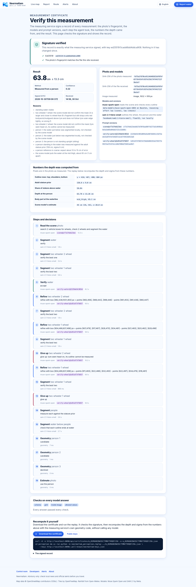
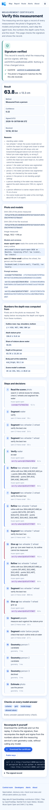
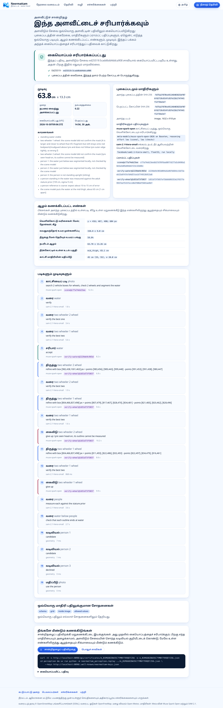
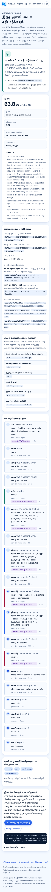

# Verifiable measurements

Every depth Neermattam publishes from a photo can be checked by someone who does not trust the service: which photo was measured, which models and prompt versions were used, what the agent decided at each step, which numbers the depth came from, and that none of it changed after the fact. This answers Meta's "Agents 102: verifiable agents" guidance with five parts, all in this repository.

| Part | Where |
|---|---|
| Prompt versions on every model step | `perception/src/neermattam_perception/muse_open.py` (`prompt_version`, `PROMPT_VERSIONS`) |
| Input hash | `media.py` (`ImageInput.source_sha256`), `input_sha256` in the response |
| Deterministic checks on every model answer | `validate.py`, wired into `muse_open.py` and `agent.py` |
| Signed measurement certificate | `certificate.py`, built in `pipeline.py`; served and checked by the gateway (`gateway/internal/certs`) |
| Replay without models | `replay.py` |
| Eval gate | `eval/gate.py`, `eval/baseline.json` |

The wire formats are in docs/CONTRACTS.md, sections 1.1 and 1.2.

## Prompt versions

Each Muse Spark Open prompt has a stable id: a short name, `@`, and the first 12 hex digits of the SHA-256 of its text. The wheel check is one template with parts chosen per call (one panel or two, the kind of wheel), so its hash covers every fixed part of the template, joined with NUL bytes; the same template gives the same id for a car wheel and a scooter wheel. Today:

| Prompt | Version |
|---|---|
| Scene reading | `scene@cf7a74eb23ee` |
| Check of a wheel outline | `verify-wheel@1d51d73f5037` |
| Check of the water region | `verify-water@2229de9c965d` |
| Voice note | `transcribe@d9fbcddc2908` |

Restructuring the wheel check into a template changed no prompt text: all 15 prompt texts (every wheel kind, one and two panels, water, scene, voice) were compared byte for byte before and after. The version is on every `agent_trace` step that called the model, including a check that failed, and the certificate lists each version with its full hash. The hosted Meta Model API path has its own id, `scene-hosted@...`, over its instructions and JSON schema.

## Input hash

`input_sha256` is the SHA-256 of the uploaded file exactly as received, before decoding, EXIF rotation or re-encoding. The gateway computes the same hash of the bytes it forwarded, so the verification page can say whether the certificate is about the file the gateway received. Voice notes carry `input_sha256` in `/v1/transcribe` too.

## Checks on every model answer

The parsers were tolerant on purpose: a coordinate off the 0 to 1000 grid was clamped onto it, a box with its corners swapped was sorted, an unknown reference kind was skipped, the string `"false"` for `adult` read as true. None of that was visible. Now every answer passes `validate.py` first:

- **schema**: each field has the type the prompt asks for;
- **grid**: points and boxes lie on the 0 to 1000 grid, boxes as `[x_min, y_min, x_max, y_max]` with `x_min < x_max` and `y_min < y_max`;
- **inside image**: every scene box, once in pixels, lies inside the photo;
- **allowed values**: reference kinds, vehicle kinds and models, postures, landmarks, positions, `choice` (`B` only when two outlines were shown), `outline_quality`, `view`, `coverage`, language codes; shares in 0 to 1; depths 0 to 1000 cm with low no higher than high.

What happens when a check fails:

| Field | First failure | Second failure |
|---|---|---|
| A field the decision rests on: `water_visible`; `is_target`, `outline_quality`, `choice` with two panels; `is_water`, `coverage`; `text` | a `validate` step, decision `retry`, and the same question again (a failing scene answer is never cached) | a `validate` step, decision `give up`: that wheel or the water is given up, or the photo is answered unusable with the reason |
| Any other field or list element | left out, named in a `validate` step (`drop N fields that failed, use the rest`) | |

Nothing is passed silently. In the live run of 30 October on c1 every answer passed, so its trace has no `validate` step and the certificate's `checks.failures` is empty. The retries count against the 55 s time budget like any other check.

## Measurement certificate

For every `/v1/measure` answer, usable or not, perception builds a record (CONTRACTS.md 1.2): the input hash and image size, the models with their exact versions (`meta-models/muse-spark-open-... on Baseten, reasoning effort low (scene), low (checks)`, `facebook/sam2.1-hiera-small, float32, run locally`), the prompt versions with full hashes, each step with its decision and prompt version, the checks and what they rejected, the geometry numbers at full precision, the decision with its reasons, and the time. Its canonical JSON (sorted keys, no spaces, ASCII) is signed with Ed25519 and carried as a string inside the envelope, so a verifier checks the exact bytes signed and never re-serialises anything; Go and Python write floating-point numbers differently, and this sidesteps that. The c1 certificate's signed text is 5,685 bytes.

**The key.** `NEERMATTAM_SIGNING_KEY` in `.env` holds a 32-byte Ed25519 seed, base64url. It is read only by perception (the Hugging Face launcher strips it from the gateway's and the engine's environment), never logged or returned. `.env.example` shows how to add one without printing it. Without it, perception makes a key for the life of the process and logs a warning; those certificates stop verifying once it restarts. Perception publishes the public key at `GET /v1/keys`.

**The gateway** keeps each certificate with its report (`GATEWAY_DATA_DIR/certificates/<measurement_id>.json`, the newest 20,000, with the SHA-256 of the file it received) and serves:

- `/verify/{measurement_id}`, "Verify this measurement", in all eight languages: whether the Ed25519 signature checks out (`crypto/ed25519`), whether the input hash matches the received file, the result, the models and prompts, the numbers, every step, the checks, how to replay it, and the signed record itself. A certificate that does not verify is shown as such, with its claims marked for inspection only;
- `/api/certificates/{measurement_id}`, the certificate as signed, with `X-Neermattam-Verified`;
- `/.well-known/neermattam-keys.json`, the trusted keys.

It trusts only keys pinned in `CERTIFICATE_PUBLIC_KEYS` and keys it fetched from perception's `/v1/keys` (at start, every 10 minutes, and once when a certificate names a key it does not know, at most every 30 seconds). Fetched keys are kept in `certificate-keys.json`, so certificates signed before a key change still verify. A key named only inside a certificate is never trusted. The result card links the page as "Verify this measurement", and the report reply carries `certificate_url`. An older perception without certificates still works: no link, and the page answers 404.

| Desktop | Phone |
|---|---|
|  |  |
|  |  |

The screenshots show the certificate of the live c1 run below, served by a stand-in perception that replays that recorded answer to the real gateway, with the real c1 photo uploaded, so the hash match is genuine.

## Replay

```sh
cd perception
uv run python -m neermattam_perception.replay ../eval/out/verify-live/c1.certificate.json
uv run python -m neermattam_perception.replay cert.json --keys https://<host>/.well-known/neermattam-keys.json
```

The file may be the certificate, a `/v1/measure` response or a gateway report reply. Without `--keys` or `--public-key` the key comes from `NEERMATTAM_SIGNING_KEY` (the operator's own check). The replay checks the signature first and stops with exit status 2 if it fails. Then it recomputes, with the service's own functions and no model call:

- **wheel**: the submerged fraction from the stored ellipse and waterline (`geometry.fraction_for`, affine or, when a camera is recorded, projective), then `geometry.compose_depth` (the calibrated bias, the outline-spread term, the model error at the visible arc) for the wheel's depth and sigma, the second waterline's disagreement (`geometry.depth_at_line`), and `pipeline.wheel_final` (tyre squash, disagreement);
- **person**: `person.person_depth_from_rows` from the four outline rows (top, the two shoulder rows, bottom) and `pipeline.person_final_sigma`;
- **estimate**: `pipeline.estimate_sigma` from the estimate and its range;
- **the decision**: which of these the published depth must equal, and, when a wheel was set aside as too shallow, that `pipeline.shallow_conflict` really says so.

`measure_wheel_depth`, `measure_person_depth` and the pipeline call these same functions, which were split out for this; a synthetic run of 30 wheel scenes and the 400-figure person check gave bit-identical numbers before and after the split. Each recorded number must match to 1e-6; the published depth and sigma, rounded to 0.1 cm, to within 0.05 cm. Exit status 0 is a match, 1 a mismatch.

**What it does not redo.** The masks are not in the certificate, so the fit of the ellipse and the waterline to them is not repeated; the replay starts from the fitted numbers. One part of a wheel's sigma, the bootstrap spread from resampling the outline points (`resample_sigma_cm`), needs those points, so it is recorded and used, not recomputed. Everything built on it is recomputed. Velocity from a video is not replayed.

**Live run, 30 October 2026**: `uv run --extra local python ../eval/real_photos.py --only c1 --no-write-results --sam-size small --out ../eval/out/verify-live`, Muse Spark Open on Baseten and SAM 2.1 hiera-small on this Mac, 55.2 s. No wheel was confirmed (one seen head-on, one outline the verifier gave up on); two of three people were measured, and the answer was `person_reference`, 63.8 plus or minus 13.3 cm. `input_sha256` equals the SHA-256 of `eval/photos/c1.jpg`. The replay:

```
signature: valid, key ed25519:5cadd6dd4ddca908 (keys from NEERMATTAM_SIGNING_KEY in the environment or .env)
input: image sha256 fd75a2f870ce91146403825df07bfd2f18c814fc83fe15b174f441f12f3ba1e7
method: person_reference
  person: visible share of stature     recorded         0.5982  recomputed         0.5982  diff +0.0000  match
  person: depth                        recorded      63.782 cm  recomputed      63.782 cm  diff +0.0000 cm  match
  person: sigma                        recorded      13.256 cm  recomputed      13.256 cm  diff +0.0000 cm  match
  person: depth at the named landmark  recorded      65.087 cm  recomputed      65.087 cm  diff +0.0000 cm  match
  estimate: sigma                      recorded      20.000 cm  recomputed      20.000 cm  diff +0.0000 cm  match
  published depth                      recorded      63.800 cm  recomputed      63.782 cm  diff -0.0184 cm  match
  published sigma                      recorded      13.300 cm  recomputed      13.256 cm  diff -0.0438 cm  match
result: match
```

The tests replay two recorded certificates (a wheel and a person, `perception/tests/fixtures/certificate_*.json`, made by `tests/fixtures/make_certificates.py` with a fixed test key), an estimate and a wheel set aside as too shallow; a tampered certificate fails its signature, and a certificate re-signed with numbers that do not add up is reported as a mismatch with the difference. The Go tests verify the same Python-signed fixtures with `crypto/ed25519` and reject tampered copies.

## Eval gate

```sh
cd perception
uv run python ../eval/gate.py                    # about 90 s; exit 1 when worse
uv run python ../eval/gate.py --write-baseline   # record an intended change
```

It runs, with fixed seeds, the synthetic wheel evaluation (200 scenes, seed 2026, 40 resampling draws; the pipeline's default method) and the synthetic person check (400 figures, seed 11), and compares them with the committed `eval/baseline.json`. It fails when, for either, the mean absolute error rises by more than 0.02 cm, or the share of errors within one stated sigma, or the share of cases measured at all, falls by more than half a percentage point. The measured share is gated too because declining hard cases would otherwise flatter the error. Each case is seeded by its index, so the numbers do not depend on the number of workers; the tolerances only absorb floating-point differences between machines. The run is smaller than the published one in docs/GEOMETRY.md (500 scenes, 100 draws), so its numbers are its own and are not quoted as accuracy.

The baseline also records the prompt versions. The real photos cannot be rerun offline (they call Muse Spark Open), so when a prompt version differs from the baseline the gate says so: rerun `eval/real_photos.py` and compare the acceptance before writing a new baseline.

Baseline of 30 October 2026:

| Eval | Measured | Mean absolute error | Within 1 sigma |
|---|---|---|---|
| Synthetic wheels (200, seed 2026, 40 draws) | 80.5% | 3.90 cm | 83.9% |
| Synthetic people (400, seed 11) | 98.5% | 6.50 cm | 86.5% |

A baseline that claims 0.1 cm less wheel error and 2 points more person coverage makes the gate fail on exactly those two rows.
